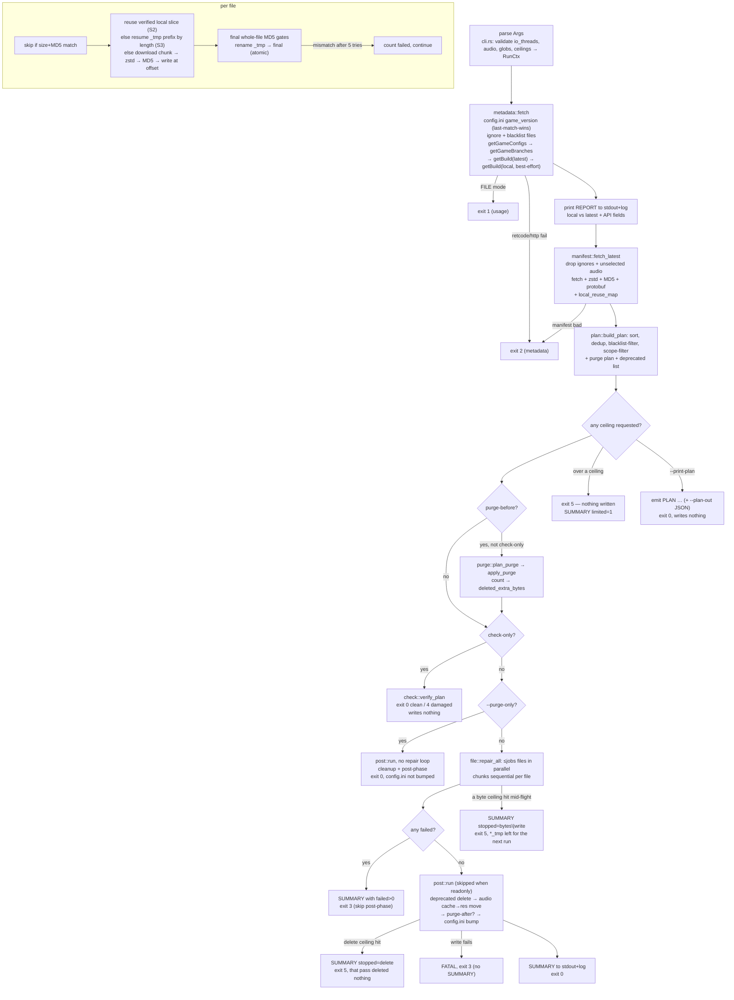

# girpr — Genshin Impact low-disk repair patcher

Brings a possibly-corrupt, possibly-any-older-version Genshin install to the
current live version with minimal extra disk. **Unattended by design:**
args in, exit code + `REPORT`/`SUMMARY` stdout lines out, no UI.

Core = **Starward's repair-in-chunk-mode** (version-agnostic, per-file
`{path}_tmp` streaming repair, verified local-chunk reuse, atomic promote)
**+ Collapse's extra-file purge** as a pre/post phase.
**Docs are two series.** The `repair-` prefix is load-bearing:

| series | docs | describes |
|---|---|---|
| **repair spec** (shipped, describes the whole-install patcher) | [`docs/01-repair-findings-and-verdict.md`](docs/01-repair-findings-and-verdict.md) · [`docs/02-repair-chunk-spec.md`](docs/02-repair-chunk-spec.md) · [`docs/03-repair-rust-implementation-plan.md`](docs/03-repair-rust-implementation-plan.md) | findings → spec → Rust module plan for `docs/02` |
| **scope limitations** (shipped) | [`docs/04-scope-limitation-options.md`](docs/04-scope-limitation-options.md) · [`docs/05-scope-limitation-implementation-plan.md`](docs/05-scope-limitation-implementation-plan.md) | `--include`/`--exclude`, byte/file ceilings, `--print-plan`, endpoint override |

The repair-spec series is not amended by the scope-limitations work; its build
plan is [`docs/05-scope-limitation-implementation-plan.md`](docs/05-scope-limitation-implementation-plan.md)
and it names the milestone that may touch them (none).

## For developers / AI agents — read this first

`src/main.rs` is a thin shim (parse → tracing → run → `SUMMARY` → exit). All
behavior is in the library; `src/repair/mod.rs::run` is the pipeline
coordinator and holds no logic beyond phase order and the exit-code contract.

**Entry points.**

| File | Owns | Key symbols |
|---|---|---|
| `src/main.rs` | shim: `Args::parse` → `init_tracing` → `repair::run` → `SUMMARY` → `exit` | `main` |
| `src/lib.rs` | module map + re-exports | — |
| `src/cli.rs` | clap `Args`, audio-lang normalization, flag validation | `Args`, `Args::into_ctx`, `parse_audio_selection`, `normalize_audio_lang`, `is_audio_none` |
| `src/config.rs` | validated run config; failure carrying the exit code | `RunCtx`, `RunCtx::readonly`, `RunCtx::api_bases`, `RunFailure` |
| `src/logging.rs` | console layer + always-`TRACE` file layer | `init_tracing`, `log_file_path` |
| `src/report.rs` | run counters + every stdout line of the contract | `Summary`, `SummaryFlags`, `Summary::snapshot`, `emit`, `format_report_line`, `format_progress`, `emit_progress`, `format_summary_line`, `spawn_progress_reporter` |
| `src/biz.rs` | biz/channel/launcher/game-id mapping | `Biz::endpoints`, `Biz::channel_tuple` |
| `src/hyp.rs` | HoYoPlay + Sophon JSON APIs | `HypClient::new`, `HypClient::new_with_bases`, `game_config`, `game_branch`, `chunk_build`, `deprecated_files`, `production_bases` |
| `src/sophon.rs` | chunk-manifest protobuf, fetch+verify+parse, manifest filter, local chunk map | `select_manifests`, `fetch_manifest`, `fetch_chunk_bytes`, `build_local_chunk_map`, `join_url` |
| `src/repair/mod.rs` | phase coordinator: plan, then assert, then execute; exit-code contract | `run` |
| `src/repair/metadata.rs` | local state + server metadata (docs/02 1–2) | `fetch`, `Meta` |
| `src/repair/manifest.rs` | manifest fetch + local chunk-reuse map (3) | `fetch_latest`, `local_reuse_map`, `LocalChunkMap` |
| `src/repair/plan/mod.rs` | work list (4) + the plan module root | `build_plan`, `RepairPlan`, `RepairPlan::expected_paths`, `RepairPlan::est_download_bytes`, `est_file_download_bytes`, `PlannedFile` |
| `src/repair/plan/purge.rs` | Collapse files-cleanup: plan (5, 7) + apply | `plan_purge`, `apply_purge`, `PurgePlan`, `PurgeCandidate`, `keep_set`, `classify_purge_path`, `PurgeVerdict` |
| `src/repair/check.rs` | `--check-only` verification (6.5) | `verify_plan` |
| `src/repair/file.rs` | per-file repair: reuse vs download, promote (6) | `repair_all`, `ChunkStats`, `Repaired` |
| `src/repair/post.rs` | deprecated/audio/`config.ini` + cleanup-after (7) | `run` |
| `src/repair/scope/mod.rs` | scope-of-work facade: path scope + ceilings | `PathScope`, `Limits`, `LimitHit` |
| `src/repair/scope/filter.rs` | `--include`/`--exclude` glob semantics (pure) | `PathScope::new`, `is_visible`, `is_active`, `is_open`, `has_includes`, `compile_patterns` |
| `src/repair/scope/limits.rs` | the pre-flight ceiling predicates (pure) | `Limits::check_preflight`, `Preflight`, `LimitHit::describe` |
| `src/repair/scope/report.rs` | the `PLAN` line + the `--plan-out` JSON document | `PlanTotals`, `format_plan_line`, `PlanDocument` |
| `src/repair/scope/ledger.rs` | the runtime reservations the hard stops read | `Summary::reserve_download_bytes`, `reserve_write_bytes`, `adjust_download_bytes`, `stop_downloads`, `stop_writes`, `abort` |
| `src/repair/audio.rs` | audio scan-file format (used by 1 and 7) | `resolve_effective_audio`, `read_scan_file`, `write_scan_file` |
| `src/util.rs` | MD5, `config.ini`, ignore/blacklist files, rel-path normalization | `md5_file`, `md5_file_slice`, `file_len`, `read_game_version`, `write_config_ini`, `read_ignore_categories`, `read_blacklist`, `normalize_rel` |
| `tests/repair_offline.rs` | offline integration/e2e (mock API) | one `#[tokio::test]` per behavior |
| `tests/cli_contract.rs` | binary-level arg handling + exit codes | one case per usage error class |
| `tests/common/mod.rs` | mock server + deterministic fixture | `MockServer`, `build_fixture`, `MockOpts` |

**Action graph** — what one `repair::run(ctx)` does (numbers = `docs/02` steps):



**Machine contracts (do not break without updating tests + this table).**

- stdout: `REPORT …` once after metadata; `PROGRESS …` every 10 s;
  `PLAN …` with `--print-plan`; `SUMMARY total=… skipped=… repaired=… failed=… download_bytes=… deleted_extra_bytes=… exit=…`.
  `--output json` emits every one of those lines as an NDJSON object instead —
  same records, same order, each carrying an `event` name.
  A **scoped or limited** run appends conditional keys to that line
  (`scoped=1`, `config_bumped=0`, `plan_files=…`, `limited=1`, …). Every one is
  emitted **only** when its flag is active, so an unflagged run's `SUMMARY` is
  byte-identical to one that never passes them.
  `local_manifest=ok|unavailable` is the one exception to "flag-driven": it is
  emitted when a local `config.ini` version was known and `getBuild(local)` was
  attempted, because that lookup is the one thing that moves both byte counts
  while still exiting `0` — see below. Absent on a fresh install.
- **The binary cannot report which chunks were requested.** `SUMMARY` is
  byte-level by design. Per-chunk request detail exists only as `trace` lines in
  `<exe-dir>/logs/girpr_<ts>.log`, so asserting "this chunk id was never
  fetched" needs a request log (`--log-level trace`), not the data plane.
- stderr: structured `tracing` logs (`--log-level` / `RUST_LOG`); always mirrored at
  `TRACE` to `<exe-dir>/logs/girpr_<timestamp>.log`.
- path scope: a path outside `--include`/`--exclude` **does not exist** — it is
  dropped from the plan *and* kept by the files-cleanup, so `--purge-*` cannot
  eat it. A scoped run does not bump `config.ini` (the bytes are deliberately
  not in place); `SUMMARY config_bumped=0` says so. `--audio` under a scope is
  exit `1`. So is an `--include` that selected **nothing at all** — but an empty
  *repair* plan on its own is not a typo: a path on disk that the new manifest
  dropped is in no repair plan by construction, so `--purge-only --include
  <that path>` deletes it rather than erroring, which is what `--purge-only`
  exists for.
- resource ceilings are **enforcement bounds, not selectors**: a run that would
  exceed one refuses (exit `5`) *before doing any work* — nothing is written,
  no directory created, no `_tmp` opened, no file deleted. They never trim the
  work list; under `--include` they are a *check on* the selection, which is why
  the two flags are not redundant. `--max-files N` with exactly N planned files
  passes (`> N`, not `>= N`). One exception to "nothing is written": a
  **runtime** hard stop, which fires mid-flight by definition. It leaves `*_tmp`
  files behind — safe, because resume-by-length makes the next run resume rather
  than restart — and `SUMMARY stopped=` says which ceiling bound and that it
  happened at all: `stopped=bytes` (`--max-download-bytes`), `stopped=write`
  (`--max-write-bytes`), `stopped=delete` (a cleanup pass refused). That key is
  what distinguishes "nothing was written because the plan was too big" from
  "something was written and then we ran out".
- `SUMMARY download_bytes` means **the bytes of files that were actually
  promoted**, as it always has. An attempt that fails and is retried hands its
  bytes back, so a run that had to retry does not report what the network cost
  the retries. The counter is nevertheless live during the repair, which is what
  `--max-download-bytes` needs to stop mid-flight.
- chunk reuse is **best-effort and the degradation is reported**:
  `SUMMARY local_manifest=unavailable` means `getBuild(local)` could not be
  served, so the reuse map was empty and *every* chunk downloaded. The run is
  still correct (more bytes, never a wrong result) and still exits `0` — but
  `download_bytes` will be far above what a run with reuse available costs, and
  a `--max-download-bytes` ceiling is measured against the same empty map, so it
  moves. Check this key before comparing byte totals.
- exit codes: `0` ok (check-only: intact) · `1` usage/config · `2` metadata/network ·
  `3` write/verify (per-file `Ok(summary,3)` with `SUMMARY`, or fatal `Err` with `FATAL` only) ·
  `4` check-only found damage · `5` a manually requested enforcement limit was
  exceeded. A **refusal** writes nothing at all; a **runtime hard stop** writes
  part of the work and leaves `*_tmp` behind (`SUMMARY stopped=…`). Either way
  `SUMMARY` is still emitted, with `limited=1`.  `5` is deliberately not `1`: the API has to be fetched first, so whether a
  limit trips depends on the server's answer — `--max-files 0` is not an error
  against an empty plan and is on a 3000-file one. Every argument-level failure
  (unknown flag, bad enum value, `--io-threads 0`, bad `--audio`, bad
  `--include` glob, non-numeric `--max-files`) is `1` — clap's default `2` is
  remapped so it cannot collide with "metadata/network". `--help` is `0`.
- `getGameConfigs.default_download_mode` must be `DOWNLOAD_MODE_CHUNK`; anything
  else (including `DOWNLOAD_MODE_FILE` / `DOWNLOAD_MODE_LDIFF`, which need the
  7z/hdiff paths v1 lacks) exits `1` instead of failing later at `getBuild`.
- `getGameDeprecatedFileConfigs` is the one API that needs `channel`/`sub_channel`,
  and it uses the per-launcher pair (cn `1/1`, global `1/0`, bili `14/0`) — the
  deprecated list is filtered by them, so cn/bilibili would get the wrong set.
- read-only modes: `--dry-run` and `--check-only` write nothing (no purge, no scan-file,
  no `config.ini`, byte counters stay 0; purge lists are only logged).
  `--purge-only` is read-only *in the repair sense* — it does the cleanup half
  and skips the repair loop. It does **not** bump `config.ini`: a cleanup puts no
  bytes in place, so claiming the newer version would desync the launcher
  (same rule as a scoped run), and on an already-current install it is a no-op
  anyway. `SUMMARY config_bumped=0` says so.
  `--print-plan` is read-only by construction too (it returns before
  `create_dir_all`) but is **not** the same thing as `--check-only`: it answers
  "what would you do", not "what is wrong". It also short-circuits `--dry-run` —
  the run returns at the plan either way, so the combination is just
  `--print-plan`. A ceiling still trips a `--print-plan` run.
- purge: `--purge-before` and `--purge-after` run the **same** cleanup, in two
  calls — `plan::purge::plan_purge` decides, `plan::purge::apply_purge` acts —
  (expected set = live-manifest paths + `config.ini` + `audio_lang_*`/`Audio_*_pkg_version`
  patterns; **everything else purges**, incl. temps, exe, logs, `ScreenShot/`).
  The whole plan is built before the first delete.
- audio: omitted flag = keep scan file (default `en-us` if unreadable); explicit list/`none`
  overwrites the scan file. `none` never mixes with langs.
- per-file spans: `file{seq,total,task,path}` — `grep 'path=<file>'` groups a file's lifecycle.

**Deliberate simplifications (do NOT "fix" without reading the linked code).**
S1 whole-blob buffering (`sophon.rs`, `repair/file.rs`) · S2 same-file-only chunk reuse
(`repair/file.rs`, `sophon::build_local_chunk_map`) · S3 resume-by-length + final-MD5 gate
(`repair/file.rs`). Purge keep-set is `config.ini`-only (`purge::keep_set`). Version parse is
last-match-wins (`util::read_game_version`, Starward parity).

## Requirements / build / usage

- Rust 1.85+ (the crate is `edition = "2024"`); network to HoYoPlay + Sophon
  CDNs (production runs only).
- Game dir (read/write); free bytes ≈ `io_threads × largest file` beyond the game.

```powershell
cargo build --release
# Preview (writes nothing)
.\target\release\girpr --game-path "D:\Genshin Impact game" --biz hk4e_global --purge-after --dry-run
# Verify only; exit 4 if damaged
.\target\release\girpr --game-path "D:\Genshin Impact game" --biz hk4e_global --check-only
# Repair + purge extras
.\target\release\girpr --game-path "D:\Genshin Impact game" --biz hk4e_global --purge-after --io-threads 4
```

| Flag | Default | Meaning |
|---|---|---|
| `--game-path <DIR>` | (required) | Install dir (`config.ini`, `*_Data`, …) |
| `--biz <BIZ>` | (required) | `hk4e_cn` \| `hk4e_global` \| `hk4e_bilibili` |
| `--audio <LANG>`… | keep current, else `en-us` | Repeatable: `zh-cn`, `en-us`, `ja-jp`, `ko-kr` (case-insensitive, `_` accepted for `-`; display names `chinese`/`english`/`english(us)`/`japanese`/`korean` also work); `none` = game-only (overwrites scan file) |
| `--io-threads <N>` | `4` | Concurrent **files** (chunks per file sequential → HDD-friendly). SSD 4–8, HDD 1–2 |
| `--purge-after` / `--purge-before` | off | Same files-cleanup, different timing (before frees repair space) |
| `--include <GLOB>` | (every path) | Repeatable. Only act on paths matching this glob (`/`-separated, relative to `--game-path`, case-insensitive). `*` also crosses `/`. Non-matching paths do not exist to the run: not repaired, **not deleted**, and `config.ini` is not bumped |
| `--exclude <GLOB>` | (nothing) | Repeatable. Treat matching paths as nonexistent; beats `--include` |
| `--max-files <N>` | (no limit) | Refuse (exit `5`) if the plan touches more than N files. `0` is a valid ceiling. Checked **after** `--include`, so it means "the files the scope selected" |
| `--max-delete-bytes <N>` | (no limit) | Refuse (exit `5`) if the files-cleanup would delete more than N bytes. Checked against the cleanup candidates computed before any work starts, and again against the post-repair pass's own candidates before it deletes anything (`stopped=delete`); out-of-scope paths are never candidates |
| `--max-download-bytes <N>` | (no limit) | Refuse (exit `5`) if the plan's **estimated** chunk downloads exceed N, and hard-stop mid-flight (exit `5`, `SUMMARY stopped=bytes`) if reuse falls back to more than the estimate predicted. Does **not** bound metadata or manifest traffic |
| `--max-write-bytes <N>` | (no limit) | Hard-stop mid-flight (exit `5`, `SUMMARY stopped=write`) once N bytes have been written into `*_tmp`. This is the **disk** cost: reuse-copies and chunk writes are counted, neither of which `download_bytes` sees |
| `--check-only` | off | Verify size+MD5; writes nothing |
| `--purge-only` | off | Make the install match the manifest: files-cleanup + post-phase, **no repair loop** (it *implies* the cleanup, so no purge flag is needed). The inverse of `--check-only`. Does not bump `config.ini` |
| `--fail-fast` | off | Stop the run once one file exhausts its retries; no further files are started. Only worth setting for `5xx`-shaped failures: a 4xx now costs nothing, because only `408`/`429`/`5xx` are retried (a 404 on a chunk is asked once, not five times) |
| `--dry-run` | off | Log actions; writes nothing |
| `--print-plan` | off | Print the whole plan (`PLAN files=… est_download_bytes=… purge_files=… purge_bytes=… max_chunk_bytes=… scoped=…`) and exit 0 without repairing, purging or bumping anything. **Not** an offline mode — the plan *is* the manifest, so it still fetches |
| `--plan-out <FILE>` | (none) | Write the per-file plan as JSON `{repair:[…],purge:[…]}` |
| `--output <text\|json>` | `text` | One human `key=value` line per record, or the same records as NDJSON (`report` / `progress` / `plan` / `summary` events). Stdout only; diagnostics stay on stderr |
| `--log-level <LVL>` | `info` | `error`/`warn`/`info`/`debug`/`trace` (`RUST_LOG` also honored) |
| `--log-file <FILE>` | `logs/girpr_<timestamp>.log` beside the executable | Write the trace log here instead. Missing parents are created. The file layer captures `TRACE` and above **regardless of `--log-level`**, so `--log-level trace` is only needed to also see it on stderr. An unopenable file is a stderr warning, never a failure |
| `--hyp-base <URL>` | production | Point the HoYoPlay API at another base (overrides `GIRPR_HYP_BASE`) |
| `--sophon-base <URL>` | production | Point Sophon `getBuild` at another base (overrides `GIRPR_SOPHON_BASE`) |

`--hyp-base` / `--sophon-base` redirect the **metadata calls only**. Manifest
and chunk URLs come from the `url_prefix` inside the response *bodies*, not from
the configured base, so a local mock must return bodies pointing at itself.

## Testing (offline by construction)

```powershell
cargo test            # 34 unit + 15 integration, all offline
cargo test --test repair_offline
cargo clippy --all-targets
```

- No test touches the internet: every case builds a `MockServer` on
  `127.0.0.1:<ephemeral>` and injects it via `RunCtx::hyp_base_override` /
  `sophon_base_override` (`src/config.rs`; resolved in `src/repair/metadata.rs`;
  `HypClient::new_with_bases` in `src/hyp.rs`).
- Binary-level e2e without code changes: set `GIRPR_HYP_BASE` / `GIRPR_SOPHON_BASE`
  env vars, or pass `--hyp-base` / `--sophon-base` (explicit > env > production;
  resolved in `RunCtx::api_bases`). `tests/repair_offline.rs` drives the real
  binary through the flags against the mock, which is the only way to prove a flag
  actually reaches `HypClient` — the library tests inject `RunCtx` directly.
- Mock shapes mirror live `hk4e_global` responses (Sept 2026): same wrappers,
  node names, int-or-string sizes, `url_prefix + "/" + id` joining. `getBuild?tag=<unknown>`
  returns `retcode -202` to exercise the local-build fallback.
- Fixture: 2 files / 3 chunks with fixed bytes (`build_fixture`); chunk fetches are
  logged (`mock.chunk_hits()`) so reuse/resume tests assert exact download sets.
- Unit tests sit next to the code they cover, one `mod tests` per module: pure
  phases only (plan, purge classification, audio scan file, `config.ini`, URL and
  query building, REPORT/SUMMARY formatting, flag validation, manifest filter,
  local chunk map).
- `tests/cli_contract.rs` runs the built binary to pin the process-level contract
  (every arg error → `1`, `--help` → `0`); it never touches a game directory.
- To add a case: extend `MockOpts` (deprecated list, audio dirs) or the fixture,
  then write one `#[tokio::test]` calling `repair::run` and asserting
  `(summary, exit code)` + on-disk state. Use `jobs=1` when asserting chunk order.

## How it keeps disk usage low

1. Files-cleanup (`--purge-before`/`--purge-after`): delete everything not in the live manifest.
2. Skip intact files (size + full MD5): 0 bytes for healthy files.
3. Chunk-level repair: only missing/corrupt chunks fetched; unchanged chunks copied from
   verified local slices (hash-gated, network fallback).
4. Per-file temp + atomic move: transient cost is one `_tmp` beside the file — no
   game duplicate, no blob store, no zip staging.
5. Post-phase: deprecated files, audio cache→res move, optional purge, `config.ini` bump.

v1 gap: expected set = latest Sophon manifest paths only (no dispatcher union, no
SDK/WPF/plugin zips — game launches without them). Chunk-repair only: no hdiff,
no 7z legacy path, no predownload, no speed limiter. Reruns are idempotent
(intact skipped, partial `_tmp` resumed by length, final MD5 re-verified).
