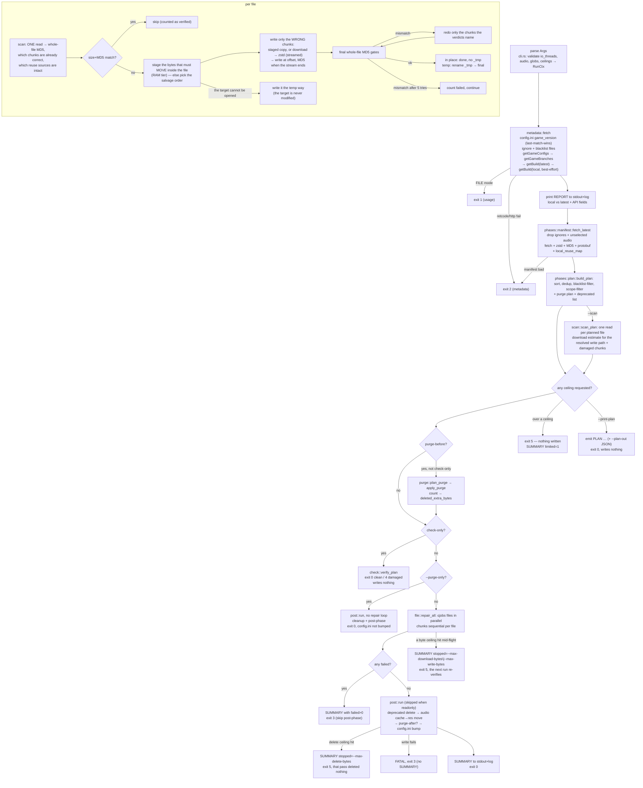

# girpr — Genshin Impact low-disk repair patcher

Brings a possibly-corrupt, possibly-any-older-version Genshin install to the
current live version with minimal extra disk. **Unattended by design:**
args in, exit code + `REPORT`/`SUMMARY` stdout lines out, no UI.

Core = **Starward's repair-in-chunk-mode** (version-agnostic, per-file repair that
writes only the bytes that are wrong, verified local-chunk reuse, a whole-file MD5
gate) **+ Collapse's extra-file purge** as a pre/post phase.
**Docs are several series.** The `repair-` prefix is load-bearing:

| series | docs | describes |
|---|---|---|
| **repair spec** (shipped, describes the whole-install patcher) | [`docs/01-repair-findings-and-verdict.md`](docs/01-repair-findings-and-verdict.md) · [`docs/02-repair-chunk-spec.md`](docs/02-repair-chunk-spec.md) · [`docs/03-repair-rust-implementation-plan.md`](docs/03-repair-rust-implementation-plan.md) | findings → spec → Rust module plan for `docs/02` |
| **scope limitations** (shipped) | [`docs/04-scope-limitation-spec.md`](docs/04-scope-limitation-spec.md) | `--include`/`--exclude`, byte/file ceilings, `--print-plan`, endpoint override |
| **artifact bridge** (shipped) | [`docs/06-artifact-bridge-spec.md`](docs/06-artifact-bridge-spec.md) | the `#[ignore]`d end-to-end test against a real bundle, and what it claims |

The repair-spec series describes the whole-install patcher and is unaffected by
the scope-limitations tier: a flag list and a byte ceiling are not a change to
the repair algorithm. `docs/04` names every `girpr` site a path scope has to
reach.

## For developers / AI agents — read this first

`src/main.rs` is a thin shim (parse → tracing → run → `SUMMARY` → exit). All
behavior is in the library; `src/repair/mod.rs::run` is the pipeline
coordinator and holds no logic beyond phase order and the exit-code contract.

**No test scans a directory it does not own.** Every scratch tree lives under
`<temp>/girpr-test/` and goes away with the test that made it; every log file
a test reads is one the test named itself, inside its own scratch. A test that
has to *find* the file it wrote is a test whose cost is the history of the
machine rather than the code.

**Entry points.**

| File | Owns | Key symbols |
|---|---|---|
| `src/main.rs` | shim: `Args::parse` → `init_tracing` → `repair::run` → `SUMMARY` → `exit` | `main` |
| `src/lib.rs` | module map + re-exports | — |
| `src/cli.rs` | clap `Args`, audio-lang normalization, flag validation | `Args`, `Args::into_ctx`, `parse_audio_selection`, `normalize_audio_lang`, `is_audio_none` |
| `src/config.rs` | validated run config; failure carrying the exit code | `RunCtx`, `RunCtx::readonly`, `RunCtx::api_bases`, `RunFailure` |
| `src/logging.rs` | console layer + file layer, over the shared log policy | `init_tracing`, `default_log_path`, `PROJECT` |
| `crates/log/` | the shared log policy: log file path, log levels, env vars | `LogPlan`, `LogOptions`, `EnvOptions`, `Level`, `filter`, `default_log_path`, `default_file_is_written`, `env_options` |
| `crates/tempdir/` | the shared scratch-directory policy: a name nothing collides with, a tree removed with the test | `TempDir`, `TempDir::new`, `TempDir::absent`, `TempDir::at`, `TempDir::subdir`, `root`, `ROOT` |
| `src/report.rs` | run counters + every stdout line of the contract | `Summary`, `SummaryFlags`, `Summary::snapshot`, `emit`, `report_record`, `progress_record`, `emit_progress`, `summary_record`, `spawn_progress_reporter` |
| `src/biz.rs` | biz/channel/launcher/game-id mapping | `Biz::endpoints`, `Biz::channel_tuple` |
| `src/hyp.rs` | HoYoPlay + Sophon JSON APIs | `HypClient::new`, `HypClient::new_with_bases`, `game_config`, `game_branch`, `chunk_build`, `deprecated_files`, `production_bases` |
| `src/sophon.rs` | chunk-manifest protobuf, fetch+verify+parse, manifest filter, local chunk map | `select_manifests`, `fetch_manifest`, `stream_chunk_to`, `HashingWriter`, `ChunkSink`, `build_local_chunk_map`, `join_url` |
| `src/repair/mod.rs` | phase coordinator: plan, then assert, then execute; exit-code contract | `run` |
| `src/repair/phases/metadata.rs` | local state + server metadata (docs/02 1–2) | `fetch`, `Meta` |
| `src/repair/phases/manifest.rs` | manifest fetch + local chunk-reuse map (3) | `fetch_latest`, `local_reuse_map`, `LocalChunkMap` |
| `src/repair/phases/plan.rs` | work list (4) + the plan module | `build_plan`, `RepairPlan`, `RepairPlan::expected_paths`, `RepairPlan::est_download_bytes`, `est_file_download_bytes`, `PlannedFile`, `PlannedFile::layout`, `Layout` |
| `src/repair/purge.rs` | Collapse files-cleanup: plan (5, 7) + apply | `plan_purge`, `apply_purge`, `PurgePlan`, `PurgeCandidate`, `keep_set`, `classify_purge_path`, `PurgeVerdict` |
| `src/repair/phases/check.rs` | `--check-only` verification (6.5) | `verify_plan` |
| `src/repair/file/mod.rs` | per-file repair: in-place patch, the temp mode, reuse vs download (6) | `repair_all`, `ChunkStats`, `Mode`, `Repaired` |
| `src/repair/reuse.rs` | the salvage order: which source survives, in which direction | `salvage_order`, `sources_for`, `Order` |
| `src/repair/scan.rs` | the `--scan` pass: the plan's exact numbers | `scan_plan`, `ScanReport`, `Verdict` |
| `src/repair/lock.rs` | the single-writer lock | `Lock::acquire`, `LOCK_FILE` |
| `src/repair/phases/post.rs` | deprecated/audio/`config.ini` + cleanup-after (7) | `run` |
| `src/repair/scope/mod.rs` | scope-of-work facade: path scope + ceilings | `PathScope`, `Limits`, `LimitHit` |
| `src/repair/scope/filter.rs` | `--include`/`--exclude` glob semantics (pure) | `PathScope::new`, `is_visible`, `is_active`, `is_open`, `has_includes`, `compile_patterns` |
| `src/repair/scope/limits.rs` | the pre-flight ceiling predicates (pure) | `Limits::check_preflight`, `Preflight`, `LimitHit::describe` |
| `src/repair/scope/report.rs` | the `PLAN` line + the `--plan-out` JSON document | `PlanTotals`, `plan_record`, `PlanDocument` |
| `src/repair/scope/ledger.rs` | the runtime ledger: the metered counters the hard stops read | `Meter`, `StoppedBy`, `Summary::reserve_download_bytes`, `reserve_write_bytes`, `note_write_bytes`, `settle_download_bytes`, `adjust_download_bytes`, `stop`, `abort` |
| `src/repair/audio.rs` | audio scan-file format (used by 1 and 7) | `resolve_effective_audio`, `read_scan_file`, `write_scan_file` |
| `src/util.rs` | MD5, the one-read scan, `config.ini`, ignore/blacklist files, server-path containment | `md5_file`, `md5_file_slice`, `scan_file`, `scan_reader`, `read_range`, `Scan`, `ScanRange`, `file_len`, `read_game_version`, `write_config_ini`, `read_ignore_categories`, `read_blacklist`, `contained_rel`, `contained_join` |
| `tests/repair_offline.rs` | offline integration/e2e (mock API) | one `#[tokio::test]` per behavior |
| `tests/cli_contract.rs` | binary-level arg handling + exit codes | one case per usage error class |
| `tests/common/mod.rs` | mock server + the fixture *description* | `MockServer`, `FixtureSpec`, `build_fixture_spec`, `MockOpts` |
| `tests/repair_machinery.rs` | the repair's own decisions, on crafted fixtures | one case per decision (D1–D9) |
| `tests/artifact_bridge.rs` | `#[ignore]`d e2e against a real `gircap` bundle (docs/06) | `drive_capture`, one test per capture |
| `tests/artifact_bridge/bundle.rs` | the bundle's records: the matrix and the patchmaps | `Patchmaps`, `Capture`, `MatrixClass` |
| `tests/artifact_bridge/server.rs` | the loopback replay server | `Bridge`, `Bundle`, `Hit` |
| `tests/artifact_server.rs` | the replay server's own tests, against a synthetic mini-bundle | one case per route family |

**Action graph** — what one `repair::run(ctx)` does (numbers = `docs/02` steps):



**Machine contracts (do not break without updating tests + this table).**

- stdout: `REPORT …` once after metadata; `PROGRESS …` every 10 s;
  `PLAN …` with `--print-plan`; `SUMMARY total=… skipped=… repaired=… failed=… download_bytes=… deleted_extra_bytes=… exit=…`.
  `--output json` emits every one of those lines as an NDJSON object instead —
  same records, same order, each carrying an `event` name.
  A **scoped or limited** run appends conditional keys to that line
  (`scoped=1`, `config_bumped=0`, `plan_files=…`, `limited=1`, …). Every one is
  emitted **only** when its flag is active, so an unflagged run's `SUMMARY` is
  byte-identical to one that never passes them.
  The byte counts come in **pairs** when their ceiling is active:
  `download_bytes` (the bytes of the files that were actually repaired) beside
  `download_bytes_spent` (the bytes that crossed the wire), and `write_bytes`
  (the bytes written from sources that passed their gate) beside
  `write_bytes_spent` (the bytes that landed in the install). The first of each
  pair is a function of the *install*, the second of the *transport*; in a
  clean run the two are the same number, and a difference is the waste.
  The two **verified** ceilings (`--max-verified-download-bytes`,
  `--max-verified-write-bytes`) bound the settled figures — the bytes the
  repair was *allowed* to spend — where the other two bound the live ones,
  the traffic and the disk the run actually took.
  `local_manifest=ok|unavailable` is the one exception to "flag-driven": it is
  emitted when a local `config.ini` version was known and `getBuild(local)` was
  attempted, because that lookup is the one thing that moves the download byte
  count while still exiting `0` — see below. Absent on a fresh install.
  The repair-mode group (`repair_mode=`, `inplace=`, `temp=`, `kept_bytes=`) is
  emitted only when `--repair-mode` was passed; `ram_bytes=` (the peak staged
  payload) only when `--max-ram-bytes` was; `damaged_chunks=` only when
  `--scan` was. `kept_bytes` is the disk claim in one number: the bytes that
  were already correct and did not have to be written — the complement of the
  **settled** writes, which are the file's, accumulated across its attempts
  (a chunk an abandoned attempt wrote is in the install, so it was not kept).
- **The binary cannot report which chunks were requested.** `SUMMARY` is
  byte-level by design. Per-chunk request detail exists only as `trace` lines in
  the log file (`--log-file <path> --log-file-level trace`), so asserting "this
  chunk id was never fetched" needs a request log, not the data plane.
- stderr: structured `tracing` logs (`--log-level`, with `RUST_LOG` adding to
  it), at `info` by default; the same events go to
  `<exe-dir>/logs/girpr_<timestamp>.log`, at `debug` by default — in a release
  build, or wherever `--log-file` points in any build (see **Logging**).
- path scope: a path outside `--include`/`--exclude` **does not exist** — it is
  dropped from the plan *and* kept by the files-cleanup, so `--purge-*` cannot
  eat it. A scoped run does not bump `config.ini` (the bytes are deliberately
  not in place); `SUMMARY config_bumped=0` says so. `--audio` under a scope is
  exit `1`. So is an `--include` that selected **nothing at all** — but an empty
  *repair* plan on its own is not a typo: a path on disk that the new manifest
  dropped is in no repair plan by construction, so `--purge-only --include
  <that path>` deletes it rather than erroring, which is what `--purge-only`
  exists for.
- resource ceilings are **enforcement bounds, not selectors**: a run that would
  exceed one refuses (exit `5`) *before doing any work* — nothing is written,
  no directory created, no `_tmp` opened, no file deleted. They never trim the
  work list; under `--include` they are a *check on* the selection, which is why
  the two flags are not redundant. `--max-files N` with exactly N planned files
  passes (`> N`, not `>= N`). One exception to "nothing is written": a
  **runtime** hard stop, which fires mid-flight by definition. It leaves the work
  it had already done in place — under `--repair-mode temp` that is a `*_tmp`
  file, and resume-by-length makes the next run resume rather than restart; in
  place, the chunks that were already correct stay correct and the next run
  re-verifies and continues — and `SUMMARY stopped=` says which ceiling bound and
  that it happened at all: the value is the **flag** that bound
  (`stopped=--max-download-bytes`, `stopped=--max-write-bytes`,
  `stopped=--max-delete-bytes`, `stopped=--max-verified-download-bytes`,
   `stopped=--max-verified-write-bytes` — a cleanup pass refused). That key is
  what distinguishes "nothing was written because the plan was too big" from
  "something was written and then we ran out".
- `SUMMARY download_bytes` means **the bytes of files that were actually
  repaired**. An attempt that fails and is retried settles nothing, so a run
  that had to retry does not report what the network cost the retries. The
  counter is nevertheless live during the repair, which is what
  `--max-download-bytes` needs to stop mid-flight — and the live figure is the
  traffic the run caused, the abandoned attempts' bytes included.
- chunk reuse is **best-effort and the degradation is reported**:
  `SUMMARY local_manifest=unavailable` means `getBuild(local)` could not be
  served, so the reuse map was empty and *every* chunk downloaded. The run is
  still correct (more bytes, never a wrong result) and still exits `0` — but
  `download_bytes` will be far above what a run with reuse available costs, and
  a `--max-download-bytes` ceiling is measured against the same empty map, so it
  moves. Check this key before comparing byte totals.
- exit codes: `0` ok (check-only: intact) · `1` usage/config (including a
  refusal because another `girpr` run holds the lock) · `2` metadata/network ·
  `3` write/verify (per-file `Ok(summary,3)` with `SUMMARY`, or fatal `Err` with `FATAL` only) ·
  `4` check-only found damage · `5` a manually requested enforcement limit was
  exceeded. A **refusal** writes nothing at all; a **runtime hard stop** writes
  part of the work, and the next run re-verifies and continues (`SUMMARY
  stopped=…`). Either way
  `SUMMARY` is still emitted, with `limited=1`.  `5` is deliberately not `1`: the API has to be fetched first, so whether a
  limit trips depends on the server's answer — `--max-files 0` is not an error
  against an empty plan and is on a 3000-file one. Every argument-level failure
  (unknown flag, bad enum value, `--io-threads 0`, bad `--audio`, bad
  `--include` glob, non-numeric `--max-files`) is `1` — clap's default `2` is
  remapped so it cannot collide with "metadata/network". `--help` is `0`.
- `getGameConfigs.default_download_mode` must be `DOWNLOAD_MODE_CHUNK`; anything
  else (including `DOWNLOAD_MODE_FILE` / `DOWNLOAD_MODE_LDIFF`, which need the
  7z/hdiff paths v1 lacks) exits `1` instead of failing later at `getBuild`.
- `getGameDeprecatedFileConfigs` is the one API that needs `channel`/`sub_channel`,
  and it uses the per-launcher pair (cn `1/1`, global `1/0`, bili `14/0`) — the
  deprecated list is filtered by them, so cn/bilibili would get the wrong set.
- read-only modes: `--dry-run` and `--check-only` write nothing (no purge, no scan-file,
  no `config.ini`, byte counters stay 0; purge lists are only logged).
  `--purge-only` is read-only *in the repair sense* — it does the cleanup half
  and skips the repair loop. It does **not** bump `config.ini`: a cleanup puts no
  bytes in place, so claiming the newer version would desync the launcher
  (same rule as a scoped run), and on an already-current install it is a no-op
  anyway. `SUMMARY config_bumped=0` says so.
  `--print-plan` is read-only by construction too (it returns before
  `create_dir_all`) but is **not** the same thing as `--check-only`: it answers
  "what would you do", not "what is wrong". It also short-circuits `--dry-run` —
  the run returns at the plan either way, so the combination is just
  `--print-plan`. A ceiling still trips a `--print-plan` run.
- purge: `--purge-before` and `--purge-after` run the **same** cleanup, in two
  calls — `purge::plan_purge` decides, `purge::apply_purge` acts —
  (expected set = live-manifest paths + `config.ini` + the single-writer lock
  + the cleaned blacklist + `audio_lang_*`/`Audio_*_pkg_version` patterns;
  **everything not kept by rules 0-4 purges**, incl. temps, exe, logs,
  `ScreenShot/`). The whole plan is built before the first delete.
- single-writer lock: a run that mutates the install takes `{game_dir}/girpr.lock`
  (`create_new`, so the creation *is* the exclusion). A live lock refuses the
  second run with **exit `1`**, naming the file and the pid; a lock older than
  24 h is taken over. A read-only run (`--check-only`, `--dry-run`,
  `--print-plan`) never takes it, and a **scoped** run does not either — the
  lock's path is outside the scope, so it does not exist to the run.
- audio: omitted flag = keep scan file (default `en-us` only when the file is **absent**; an unreadable scan file fails the run rather than silently replacing the selection). An empty scan file is the game-only choice, not absence. A non-empty scan file that names no known language is a config error (exit `1`, naming the file and the offending line) rather than an empty selection `--purge-after` would act on. Explicit list/`none` overwrites the scan file atomically, in the execution phase after every plan-half refusal. `none` never mixes with langs.
- per-file spans: `file{seq,total,task,path}` — `grep 'path=<file>'` groups a file's lifecycle.

**Deliberate simplifications (do NOT "fix" without reading the linked code).**
S1 no manifest cache in `game_dir` (`sophon.rs`, `repair/phases/manifest.rs`) · S2 same-file-only chunk reuse
(`repair/file/mod.rs`, `sophon::build_local_chunk_map`). Purge keep-set is `config.ini` + the
single-writer lock (`purge::keep_set`); the cleaned blacklist is a separate keep input
(`purge::plan_purge`). Version parse is last-match-wins
(`util::read_game_version`, Starward parity).

**Resume.** The two write modes resume differently, and each in the way that suits it:
the in-place path resumes by **verification** — the scan finds the chunks that are already
correct where they belong, and the next run rewrites only the rest, which cannot inherit a
corrupt prefix and needs no artefact at all; the temp mode resumes by **length**, keeping
the completed `*_tmp` prefix and continuing it.

## Requirements / build / usage

- Rust 1.85+ (the crate is `edition = "2024"`); network to HoYoPlay + Sophon
  CDNs (production runs only).
- Game dir (read/write); free bytes ≈ `io_threads × largest file` **growth**
  beyond the game (0 for a same-size repair — the in-place path writes only
  the wrong bytes). `--repair-mode temp` needs the whole file instead.

```powershell
cargo build --release
# Preview (writes nothing)
.\target\release\girpr --game-path "D:\Genshin Impact game" --biz hk4e_global --purge-after --dry-run
# Verify only; exit 4 if damaged
.\target\release\girpr --game-path "D:\Genshin Impact game" --biz hk4e_global --check-only
# Repair + purge extras
.\target\release\girpr --game-path "D:\Genshin Impact game" --biz hk4e_global --purge-after --io-threads 4
```

| Flag | Default | Meaning |
|---|---|---|
| `--game-path <DIR>` | (required) | Install dir (`config.ini`, `*_Data`, …) |
| `--biz <BIZ>` | (required) | `hk4e_cn` \| `hk4e_global` \| `hk4e_bilibili` |
| `--audio <LANG>`… | keep current, else `en-us` | Repeatable: `zh-cn`, `en-us`, `ja-jp`, `ko-kr` (case-insensitive, `_` accepted for `-`; display names `chinese`/`english`/`english(us)`/`japanese`/`korean` also work); `none` = game-only (overwrites scan file) |
| `--io-threads <N>` | `4` | Concurrent **files** (chunks per file sequential → HDD-friendly). SSD 4–8, HDD 1–2 |
| `--purge-after` / `--purge-before` | off | Same files-cleanup, different timing (before frees repair space) |
| `--include <GLOB>` | (every path) | Repeatable. Only act on paths matching this glob (`/`-separated, relative to `--game-path`, case-insensitive). `*` also crosses `/`. Non-matching paths do not exist to the run: not repaired, **not deleted**, and `config.ini` is not bumped |
| `--exclude <GLOB>` | (nothing) | Repeatable. Treat matching paths as nonexistent; beats `--include`. A content glob such as `mods/*` hides the files under `mods` but not `mods` itself, so an empty `mods` directory is still visible and may be swept; a directory is hidden only when the glob matches the directory path itself |
| `--max-files <N>` | (no limit) | Refuse (exit `5`) if the plan touches more than N files. `0` is a valid ceiling. Checked **after** `--include`, so it means "the files the scope selected" |
| `--max-delete-bytes <N>` | (no limit) | Refuse (exit `5`) if the files-cleanup would delete more than N bytes. Checked against the cleanup candidates computed before any work starts, and again against the post-repair pass's own candidates before it deletes anything (`stopped=--max-delete-bytes`); out-of-scope paths are never candidates. If a ceiling is set and the purge plan is incomplete (`purge_errors>0`, a walk/stat failure), the run refuses (exit `5`) instead of deleting against a lower bound |
| `--max-download-bytes <N>` | (no limit) | Refuse (exit `5`) if the plan's **estimated** chunk downloads exceed N, and hard-stop mid-flight (exit `5`, `SUMMARY stopped=--max-download-bytes`) if reuse falls back to more than the estimate predicted. Without `--scan` the estimate is an **upper bound**: it counts every chunk the local reuse map cannot supply, while the in-place path keeps the chunks that are already correct. With `--scan` it resolves the write path the run will take (temp, discard or in place) and the ordered salvage tier, so it no longer counts sources that direction overwrites; it is still an over-approximation under the staged tier and cannot predict an in-place open that falls back to temp, which the runtime stop bounds. Does **not** bound metadata or manifest traffic |
| `--max-write-bytes <N>` | (no limit) | Hard-stop mid-flight (exit `5`, `SUMMARY stopped=--max-write-bytes`) once N bytes have been written into the install. This is the **disk** cost: reuse-copies and chunk writes are counted, neither of which `download_bytes` sees. With the in-place path it counts only the bytes that are wrong. The two halves are reported: `SUMMARY write_bytes_spent` is the live figure the ceiling bounds (the bytes that landed, gate or no gate), and `SUMMARY write_bytes` is the settled one — the bytes written from sources that passed their gate, so it is a function of the install and not of the transport (a corrupt chunk contributes nothing) |
| `--max-verified-download-bytes <N>` | (no limit) | Hard-stop mid-flight (exit `5`, `SUMMARY stopped=--max-verified-download-bytes`) once N bytes of **verified** downloads have been made — the bytes of the files that were actually repaired, not the traffic the run caused. A budget on the *repair* rather than on the network: a retry that fetched the same chunk twice, and a chunk that failed its digest, cost nothing here. Cannot be a pre-flight refusal — the split between the two figures is only known at runtime, so the line is checked when a file is repaired and can be crossed by that one file |
| `--max-verified-write-bytes <N>` | (no limit) | Hard-stop mid-flight (exit `5`, `SUMMARY stopped=--max-verified-write-bytes`) once N bytes have been written into the install **from sources that passed their gate**. The same split as `--max-write-bytes`, on the other half: the bytes that landed without passing a gate are spent and are what `--max-write-bytes` bounds; this bounds the bytes the repair was allowed to spend. Cannot be a pre-flight refusal — the split between the two figures is only known at runtime, so the line is checked when a write is settled and can be crossed by that one write |
| `--repair-mode <auto\|inplace\|temp\|discard>` | `auto` | How each file is written. `auto`/`inplace`: write only the wrong bytes, in place (no `_tmp`, and the peak extra disk is the file's growth). `temp`: assemble the repair in `{path}_tmp` and rename it over the target — **the target file is never modified** and the swap is atomic, at the cost of the whole file existing twice. `discard`: delete the target and write it from scratch (no second copy: 0 extra disk when the target is already full size, its growth when it is truncated, and a full download). A target that cannot be opened for writing is written the `temp` way, loudly |
| `--max-ram-bytes <N>` | (no limit) | Cap the RAM the in-place repair may stage the bytes it has to move *inside* a file. A file that cannot get its reservation is written in the other direction instead — the same file, with less reuse. `0` means "stage nothing at all" |
| `--scan` | off | Read the whole install once, in the plan phase, so the plan's numbers are exact: the bytes the repair will really download, the chunks that are damaged, and the bytes the scan read. Costs a full read of every planned file |
| `--check-only` | off | Verify size+MD5; writes nothing |
| `--purge-only` | off | Make the install match the manifest: files-cleanup + post-phase, **no repair loop** (it *implies* the cleanup, so no purge flag is needed). The inverse of `--check-only`. Does not bump `config.ini` |
| `--fail-fast` | off | Stop the run once one file exhausts its retries; no further files are started. Only worth setting for `5xx`-shaped failures: a 4xx costs nothing on its own, because only `408`/`429`/`5xx` are retried (a 404 on a chunk is asked once, not five times) |
| `--dry-run` | off | Log actions; writes nothing |
| `--print-plan` | off | Print the whole plan (`PLAN files=… est_download_bytes=… est_write_bytes=… est_extra_bytes=… purge_files=… purge_bytes=… max_chunk_bytes=… scoped=…`) and exit 0 without repairing, purging or bumping anything. Under `--scan` the line also carries `scan_bytes=`. **Not** an offline mode — the plan *is* the manifest, so it still fetches |
| `--plan-out <FILE>` | (none) | Write the per-file plan as JSON `{repair:[…],purge:[…]}`. Works with or without `--print-plan`; on its own it writes the plan of the run that then does the work (before the first mutation, so a write failure is exit `3` with nothing changed) |
| `--output <text\|json>` | `text` | One human `key=value` line per record, or the same records as NDJSON (`report` / `progress` / `plan` / `summary` events). Stdout only; diagnostics stay on stderr |
| `--log-level <LVL>` | `info` | The **console's** verbosity: `error`/`warn`/`info`/`debug`/`trace`. `RUST_LOG` *adds* to it — it can turn up other crates, but it cannot change this program's own level |
| `--log-file-level <LVL>` | `debug` | The **log file's** verbosity: `error`/`warn`/`info`/`debug`/`trace`. `GIRPR_LOG_FILE_LEVEL` says otherwise when the flag is absent. Separate from `--log-level` because the console is read while the run happens and the file is read afterwards |
| `--log-file <FILE>` | `logs/girpr_<timestamp>.log` beside the executable (release builds only) | Where the log file goes. `GIRPR_LOG_FILE` names one when this flag does not; the flag wins. Missing parents are created. An unopenable file is a stderr warning, never a failure |
| `--no-log-file` | off | Write no log file at all. Turns the default off in a release build, and says so explicitly in a debug build. Cannot be combined with `--log-file`: the two say opposite things about the same file. The console is unaffected |
| `--hyp-base <URL>` | production | Point the HoYoPlay API at another base (overrides `GIRPR_HYP_BASE`) |
| `--sophon-base <URL>` | production | Point Sophon `getBuild` at another base (overrides `GIRPR_SOPHON_BASE`) |

`--hyp-base` / `--sophon-base` redirect the **metadata calls only**. Manifest
and chunk URLs come from the `url_prefix` inside the response *bodies*, not from
the configured base, so a local mock must return bodies pointing at itself.

## Logging

One policy, three programs: this binary and the two dev tools (`gircap`,
`girsync`). It lives in `crates/log/` and is the only thing they share that
ships.

- **A release build always writes a log file; a debug build writes one only when
  it is asked to.** A release build's default is
  `<exe-dir>/logs/<project>_<timestamp>.log` — `logs/girpr_….log` here. A
  debug build writes no file by default: it is the build a developer and a
  test suite run, and a file per run in a directory nobody reads is a
  directory that grows by one file per run, forever. `--no-log-file` turns the
  file off in any build.
- **Where it goes**, in order of precedence: `--no-log-file`, then
  `--log-file`, then `GIRPR_LOG_FILE`, then the default. `--no-log-file` wins
  because "write no log file" is the more specific thing to have said; the
  flag beats the environment because the flag was typed by the person running
  the tool and an environment variable is whatever the shell happened to
  export.
- **Two levels, not one.** `--log-level` is the **console's** (`info` by
  default); `--log-file-level` is the **file's** (`debug` by default, or
  `GIRPR_LOG_FILE_LEVEL`). They are separate because they answer separate
  questions: the console is for the person watching the run, the file is for
  the person reading it afterwards.
- **`RUST_LOG` adds to the console; it does not replace it.** The console's
  spec is this program's own directive (`girpr=info`) with `RUST_LOG`'s
  directives in front of it, so `RUST_LOG=reqwest=debug` turns up `reqwest`
  beside the program's own events, and cannot silence the program — and cannot
  change *its* level either, because `--log-level` is what the person running
  the tool typed.
- **A log file that cannot be opened is a warning, never a failure.** A run
  must not end differently because of where it was asked to log.
- The **format** is not shared: this binary writes a human-readable text log,
  meant to be read with `grep 'path=<file>'`; the two dev tools write JSON
  lines, meant to be parsed.

## Testing (offline by construction)

The runner is **`cargo nextest`** — `cargo install cargo-nextest --locked`, or
the prebuilt release for the platform. Every crate in the workspace (`girpr`,
`girpr-log`, `girpr-tempdir`, `gircap`, `girsync`) runs its suite with it, and
[`.config/nextest.toml`](.config/nextest.toml) holds the shared defaults.

```powershell
cargo nextest run             # 265 tests in this package, all offline
cargo nextest run --workspace # the whole workspace: girpr, girpr-log, girpr-tempdir, gircap, girsync
cargo nextest run --test repair_offline
cargo nextest run --test repair_machinery
cargo clippy --all-targets

# the artifact bridge: #[ignore]d, needs a bundle (docs/06)
cargo nextest run -p girpr --test artifact_bridge --run-ignored only --no-capture
```

- **`cargo nextest run` is not `cargo test`.** It runs each test in its own
  process, which is what makes the suite's isolation real rather than
  incidental: a test that leaks a global, a temp directory or an environment
  variable cannot reach the next one. Three things follow from it.
  - A `#[ignore]`d test is skipped unless `--run-ignored only` (or
    `--run-ignored all`) says otherwise — same rule as `cargo test`, different
    spelling. nextest also accepts libtest's `-- --ignored`, but the native
    flag is the one to type.
  - **`--nocapture` is `--no-capture`** — nextest's spelling, and the only one
    it has. (`--no-capture` also runs the suite serially, because a captured
    output cannot be interleaved.)
  - **Doctests are not run.** Nextest has no doctest support at all, so the
    workspace's doctests — the examples in `crates/log/src/lib.rs` and
    `crates/tempdir/src/lib.rs` — are mirrored by unit tests beside them, and
    `cargo nextest run` alone covers everything the suite covers.

- No test touches the internet: every case builds a `MockServer` on
  `127.0.0.1:<ephemeral>` and injects it via `RunCtx::hyp_base_override` /
  `sophon_base_override` (`src/config.rs`; resolved in `src/repair/phases/metadata.rs`;
  `HypClient::new_with_bases` in `src/hyp.rs`).
- **One scratch-directory policy, three projects.** A test that needs a tree of
  its own gets it from `crates/tempdir/` — a dev-dependency of `girpr`,
  `gircap` and `girsync` alike. The name carries the pid, a timestamp and a
  per-process counter, so two runs — or two `cargo nextest run` invocations —
  never share a tree, and the guard removes the tree when the test ends
  however it ends. It used to be six copies of this, three of them in the same
  project, each of which had to be kept in step by hand.
  Every one of those trees lives under **one** directory in the system temp
  directory: `<temp>/girpr-test/`. So a directory left behind by a killed run
  is recognisable as this project's — "whose leftover is this?" has an answer —
  and the whole of what this workspace wrote to the temp directory is one
  directory to look at.
- Binary-level e2e without code changes: set `GIRPR_HYP_BASE` / `GIRPR_SOPHON_BASE`
  env vars, or pass `--hyp-base` / `--sophon-base` (explicit > env > production;
  resolved in `RunCtx::api_bases`).
- **What the tests actually drive.** `tests/repair_offline.rs` is 74 cases, and
  most of them call `repair::run(ctx)` **in-process** with a hand-built `RunCtx`
  — that exercises the library, not the flag surface. Six of them (the
  endpoint-override cases, the `--output` format case, the scan estimate and the
  scoped cleanup) spawn the real binary through `CARGO_BIN_EXE_girpr`, which is
  how the `--hyp-base` / `--sophon-base` precedence is pinned; they still run
  against the mock, not against real bytes.
  `tests/cli_contract.rs` is the other file that spawns the binary, and it never
  reaches the API at all — it is argument handling and exit codes only.
- **The repair's own decisions are on crafted fixtures.**
  `tests/repair_machinery.rs` is 25 cases, one per decision the repair makes
  per file — the tier, the write direction, the trim, the growth, the mode, the
  resume, and what a malformed manifest does — plus the four facts the run
  reports on its data plane (the live and the settled byte figures agree,
  `local_manifest` says `ok` or `unavailable`, the scope contains the run, and
  the trace log's download records agree with the server's request log). They
  run the **real binary** against the mock, because several of those decisions
  are only visible on the `--output json` records.
  The fixtures are **described**, not hardcoded: `tests/common/mod.rs` takes a
  `FixtureSpec` — the new side, the old side and the bytes on disk — so a
  uniform shift, a mixed shift, a shrinking file, a file with a hole in its
  coverage and a path with a space in it are all a description rather than a
  builder of their own. A case costs kilobytes.
- **The replay server has its own tests, against a synthetic mini-bundle.**
  `tests/artifact_server.rs` builds a bundle of a few kilobytes — two `getBuild`
  bodies, one carried manifest per build, one chunk blob, the recorded failure
  shapes — and drives the server over it: the surgical `url_prefix` rewrite,
  the `build_id` invariant, the request log, and the recorded not-found shapes.
  It is always on and it takes no time, because the server's behaviour does not
  depend on the bundle being hundreds of megabytes of real game bytes.
- **Real bytes, real flags — and expensive.** `tests/artifact_bridge.rs` runs
  the built binary against a `gircap` artifact bundle replayed over loopback,
  which is what proves `--include` and `--hyp-base` / `--sophon-base` reach
  `HypClient` through the real flag-parsing path. It is **`#[ignore]`d because
  it costs real binary runs over ~20 MB of bundle bytes per run**, and it is
  meant to be started **by hand, only when a repair-spec change is
  suspected**:
  ```powershell
  cargo nextest run -p girpr --test artifact_bridge --run-ignored only --no-capture
  ```
  It still *compiles* under `cargo nextest run`, so a broken bridge fails to
  build rather than failing silently. And because it only ever runs
  deliberately, a **missing prerequisite is an error**: no bundle under
  `artifacts/` and no `GIRPR_ARTIFACT_BUNDLE` fails the run with the command
  that would produce one, rather than passing quietly having checked nothing.
  - The spec is [`docs/06-artifact-bridge-spec.md`](docs/06-artifact-bridge-spec.md).
  - The server rewrites only the **scheme and authority** of the `url_prefix`
    inside each `getBuild` body, because manifest and chunk URLs are built from
    that body rather than from the flags. It never writes to the bundle; the
    working tree is a scratch copy, and `gircap verify` must still pass
    afterwards.
  - **What it claims, and only that:** `girpr`'s output is identical to what
    another repair tool computes. Three assertions per capture — the patched
    file's bytes are the reference bytes, the chunks asked for are exactly the
    chunks the patch says must be fetched (and none of the ones it says can be
    reused), and the byte total is the patch's byte total — plus the run's
    preconditions: exit `0`, `local_manifest` did not come back `unavailable` (a
    run with no local manifest still exits `0`, downloads everything, and is the
    failure mode byte counts alone will not catch), `scoped=1` and
    `config_bumped=0`.
  - **Everything else about `girpr` is tested elsewhere**, on fixtures where the
    answer is exact and the cost is nothing: the tier, the direction, the trim
    and the rest are in `tests/repair_machinery.rs`.
- Mock shapes mirror live `hk4e_global` responses (Sept 2026): same wrappers,
  node names, int-or-string sizes, `url_prefix + "/" + id` joining. `getBuild?tag=<unknown>`
  returns `retcode -202` to exercise the local-build fallback.
- Fixture: 2 files / 3 chunks with fixed bytes (`build_fixture`), plus a
  **moved** fixture (`build_moved_fixture`) whose old file has a different
  chunk layout from the new one — the case where the bytes have to move
  *inside* the file. Chunk fetches are logged (`mock.chunk_hits()`) so
  reuse/resume tests assert exact download sets.
- Unit tests sit next to the code they cover, one `mod tests` per module: pure
  phases only (plan, purge classification, audio scan file, `config.ini`, URL and
  query building, REPORT/SUMMARY formatting, flag validation, manifest filter,
  local chunk map).
- `tests/cli_contract.rs` runs the built binary to pin the process-level contract
  (every arg error → `1`, `--help` → `0`); it never touches a game directory.
- To add a case: extend `MockOpts` (deprecated list, audio dirs) or describe a
  new fixture, then write one `#[tokio::test]` calling `repair::run` and
  asserting `(summary, exit code)` + on-disk state. Use `jobs=1` when asserting
  chunk order.

## How it keeps disk usage low

1. **In-place repair (the default).** A repair writes only the bytes that are wrong, at the
   offsets they belong at, into the file itself. The peak extra disk is the file's
   **growth**, not its size — so a same-size repair of a 2 GB file needs **0** extra bytes.
2. Files-cleanup (`--purge-before`/`--purge-after`): delete everything not in the live manifest.
3. Skip intact files (size + full MD5): 0 bytes for healthy files.
4. Chunk-level repair: only missing/corrupt chunks fetched; unchanged chunks kept in place, or
   copied from a verified local slice (hash-gated, network fallback).
5. **Resume by verification**: an interrupted run leaves a file that fails the same check, and
   the next run finds the chunks that are already right and rewrites only the rest. No
   `_tmp` artefact, no blob store, no zip staging.
6. Post-phase: deprecated files, audio cache→res move, optional purge, `config.ini` bump.

**Two ways to write a file — two ways to spend disk, and each with a property of its own:**

| mode | how the file is written | peak extra disk | the property it gives you |
|---|---|---|---|
| `inplace` (default) | the wrong bytes are written into the file, at the offsets they belong at | the file's **growth** (0 for a same-size repair) | the least disk and the least writing, and a rerun that re-verifies and continues |
| `temp` (`--repair-mode temp`) | the repair is assembled in `{path}_tmp` and swapped over the target with an atomic rename | the whole file | **the target file is never modified** — a repair that fails leaves it exactly as it was, and the swap is atomic |
| `discard` (`--repair-mode discard`) | the target is deleted and written from scratch | the file's **growth** (0 when the target is already full size), never a second copy | a file with nothing reusable in it, written without asking the network twice |

The whole-file MD5 is the gate in every mode, `config.ini` advances only when every planned
file verified, and `--scan` reports the exact figures before any of it starts. The two modes
also resume differently, and each in the way that suits it: the in-place path finds the
chunks that are already right and rewrites only the rest, so it has no artefact to resume
from and cannot inherit a corrupt prefix; the temp mode keeps the completed `*_tmp` prefix
and continues it.

v1 gap: expected set = latest Sophon manifest paths only (no dispatcher union, no
SDK/WPF/plugin zips — game launches without them). Chunk-repair only: no hdiff,
no 7z legacy path, no predownload, no speed limiter. Reruns are idempotent
(intact skipped, partial files finished by verification, final MD5 re-verified).
