# `girpr` repair process — visual flow atlas

From **process launch** to **process exit**, in 22 diagrams across five zoom levels.
Every node name is a real function/type in this repository; `path:line` anchors point at
the current checkout. The binary is a thin shim — `src/main.rs` — and all behavior lives
in the library, coordinated by `repair::run` in `src/repair/mod.rs`, which owns **only**
phase order and the exit-code contract.

> **How to read this atlas**
> - **L0** — the operating-system view (process, runtime, exit status).
> - **L1** — the seven top-level stages, split into a read-only **plan half** and a
>   write-capable **execute half**.
> - **L2** — one diagram per phase (metadata, manifest, plan, check, repair, post,
>   purge, persistent, ceilings, reporting).
> - **L3** — the per-file algorithm: write-mode resolution, in-place tiers, temp mode,
>   streamed chunk download.
> - **L4** — the supporting value/decision leaves and resume state machines.

Colour legend used in flowcharts:

| Class | Meaning |
|---|---|
| `plan` (blue) | read-only; no install mutation |
| `exec` (orange) | write-capable; may mutate the install |
| `net` (purple) | network / server call |
| `data` (green) | data artifact handed between phases |
| `exit` (red) | a terminal outcome with an exit code |

---

## Index

| # | Level | Diagram | Type |
|---|---|---|---|
| 1 | L0 | Process lifecycle — launch to exit | flowchart |
| 2 | L0 | Exit-code decision map | flowchart |
| 3 | L1 | The whole run in one picture: two halves, seven stages | flowchart |
| 4 | L1 | Data hand-off between phases | flowchart |
| 5 | L2 | `plan_phase` in full | flowchart |
| 6 | L2 | `metadata::fetch` — two HYP waves plus local reads | sequenceDiagram |
| 7 | L2 | `fetch_plan_network` — five-way fan-out | flowchart |
| 8 | L2 | `build_and_assert_plan` — plan, scope, scan, ceilings | flowchart |
| 9 | L2 | `execute_phase` in full | flowchart |
| 10 | L2 | Files-cleanup: `plan_purge` → `apply_purge` | flowchart |
| 11 | L2 | Resource ceilings: refusal vs hard stop | stateDiagram-v2 |
| 12 | L2 | The `--with-persistent` tier | flowchart |
| 13 | L2 | Post-phase and the final `config.ini` bump | flowchart |
| 14 | L2 | Stdout record stream and the log channel | sequenceDiagram |
| 15 | L3 | Per-file repair: complete decision flow | flowchart |
| 16 | L3 | In-place path internals and the two tiers | flowchart |
| 17 | L3 | Temp path internals and resume-by-length | flowchart |
| 18 | L3 | Streamed chunk fetch, decode and digest gate | sequenceDiagram |
| 19 | L4 | Write-mode resolution | flowchart |
| 20 | L4 | Module / crate dependency map | flowchart |
| 21 | L4 | Resume state machine — same-size upgrade per mode | stateDiagram-v2 |
| 22 | L3 | `--check-only` verification detail | flowchart |

---

## 1. L0 — Process lifecycle: launch to exit

`src/main.rs:15` (`main`) is the shim: parse → tracing → config → runtime → `run` → `SUMMARY` → flush → exit code.

```mermaid
flowchart TD
    classDef plan fill:#e3f2fd,stroke:#1565c0,color:#0d47a1
    classDef exec fill:#fff3e0,stroke:#ef6c00,color:#e65100
    classDef exit fill:#ffebee,stroke:#c62828,color:#b71c1c
    classDef data fill:#e8f5e9,stroke:#2e7d32,color:#1b5e20

    START(["OS launches girpr.exe"]) --> PARSE["parse_args() — src/main.rs:154<br/>Args::try_parse — clap, one flat struct, no subcommands"]
    PARSE --> PC{"clap result"}
    PC -->|"help or version"| H0["print help or version<br/>girpr_cli::clap_error_code → 0"]
    PC -->|any other parse error| E1A["e.print() + process::exit(1)<br/>NO log file, NO SUMMARY"]
    PC -->|Ok Args| LOG["init_tracing(...) — src/logging.rs:102<br/>LogPlan::resolve → stderr layer + optional file layer<br/>try_init + install_guard"]
    LOG --> ANN["log_file_announcement → eprintln if caller named a file"]
    ANN --> CTX{"args.into_ctx() — src/cli.rs:302<br/>jobs 1..=1024, audio aliases and none, glob compile,<br/>ceilings, repair mode, backoff"}
    CTX -->|Err| E1B["ERROR ... + flush_log() → exit 1"]
    CTX -->|Ok RunCtx| RT["worker_threads(max(2,avail)+1)<br/>tokio multi-thread runtime build"]
    RT -->|build Err| E1C["exit 1"]
    RT -->|Ok| MRUN["runtime.block_on(main::run(ctx)) — src/main.rs:106"]
    MRUN --> PIPE["girpr::run = repair::run(ctx) — src/repair/mod.rs:104<br/>PhaseTimer('run') + Summary::default()"]
    PIPE --> PLAN["plan_phase — read-only<br/>see diagram 5"]
    PLAN --> EXEC["execute_phase — write-capable<br/>see diagram 9"]
    PLAN -.->|Limit or print-plan| EARLY["PlanOutcome::Finished(RunExit)"]
    PIPE --> RES{"repair::run result"}
    EARLY --> RES
    EXEC --> RES
    RES -->|Ok (summary, code)| SUM["emit(summary_record(summary, code.code()))<br/>THE ONLY SUMMARY call site — stdout + log"]
    RES -->|Err RunFailure| FATAL["tracing::error + eprintln FATAL<br/>NO SUMMARY on fatal error"]
    SUM --> FLUSH["flush_log() — drop WorkerGuard, drain queue"]
    FATAL --> FLUSH
    FLUSH --> EXIT["exit_code(code) → ExitCode::from(process_status())"]
    H0 --> FIN(["OS process exit"])
    E1A --> FIN
    E1B --> FIN
    E1C --> FIN
    EXIT --> FIN

    class PARSE,LOG,CTX,RT plan
    class MRUN,PIPE,PLAN,EXEC exec
    class SUM,FLUSH,EXIT data
    class E1A,E1B,E1C,H0,FATAL,EARLY exit
```

**Contracts pinned here**
- Clap errors are remapped: `DisplayHelp`/`DisplayVersion` → `0`, everything else → `1`
  (`crates/cli/src/lib.rs:16`, `clap_error_code`). Parse errors happen *before* `init_tracing`,
  so they create no log file.
- Logging is infallible: an unopenable log file is a `WARN`, never a failed run.
  `RUST_LOG` *adds* to the console filter; it cannot lower `girpr`'s own level.
- `SUMMARY` is emitted exactly once, by `main`, for every non-fatal return. A fatal
  `Err(RunFailure)` prints `FATAL` instead and has **no** `SUMMARY`.

---

## 2. L0 — Exit-code decision map

The table is `define_exit_table!` in `src/config.rs:28` using the shared macro in
`crates/exit/src/lib.rs`. Codes are contiguous from zero and compile-time pinned.

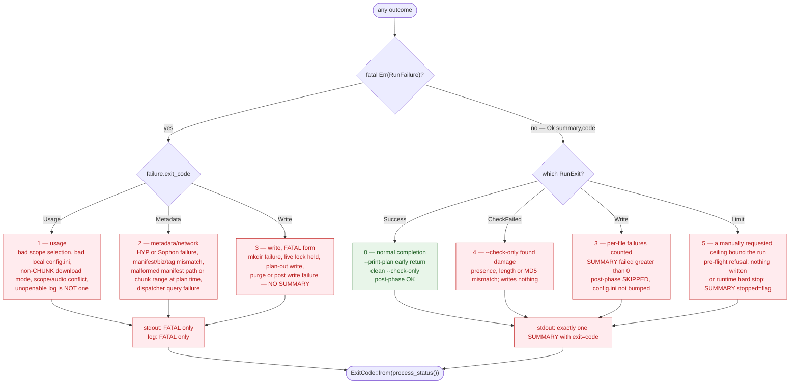

**Subtleties**
- `5` is deliberately not `1`: the API has to be fetched first, so whether a limit trips
  depends on the server's answer.
- A failed file **outranks** a limit: `failed_file_outranks_outcome` (`mod.rs:1554`)
  converts `Limit` to `Write` (3) and skips the post phase.
- Pre-flight refusal writes nothing at all; a runtime hard stop leaves the completed
  prefix in place and `SUMMARY stopped=<flag>` says which ceiling bound.

---

## 3. L1 — The whole run in one picture: two halves, seven stages

Authoritative order from `src/repair/mod.rs:32-44`. The plan half decides everything and
touches nothing; every write and delete lives in the execute half.

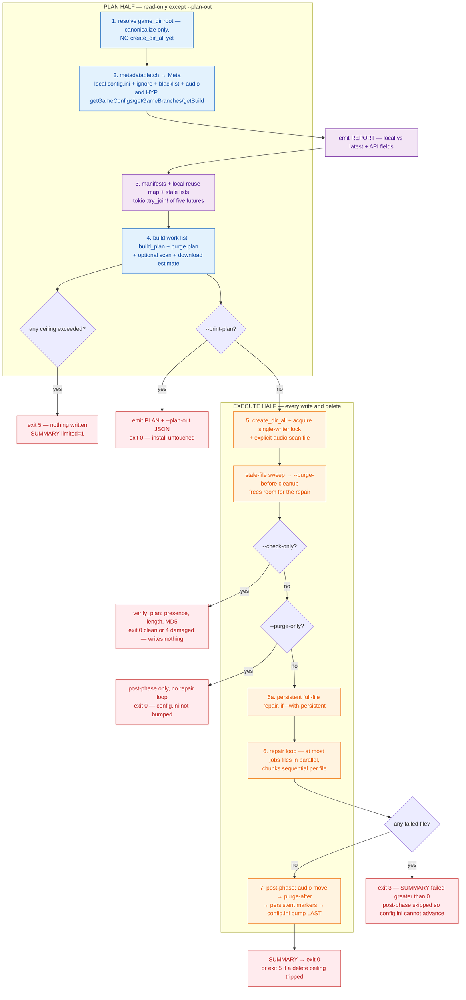

The same seven stages, as a compact linear spine (for a quick mental model):

```
launch ─ parse ─ trace ─ ctx ─ runtime ─┐
                                       ├─ PLAN:  root → metadata → REPORT → manifest ─┐
                                       │                                             ├─ plan → scan → ceilings → PLAN
                                       ├─ EXEC:  mkdir → lock → audio → stale → purge-before ─┐
                                       │                                                     ├─ check | purge-only | persistent
                                       │                                                     ├─ repair loop → failed? → 3
                                       └─ finish ─ post → config.ini → SUMMARY ─ flush ─ exit ─┘
```

---

## 4. L1 — Data hand-off between phases

No `RepairSession` or `RepairContext` type exists. The state holders are `RunCtx`,
`Meta`, `PlanPhase`, `PlanWork`, `Summary` and the `Arc`-shared plan values.

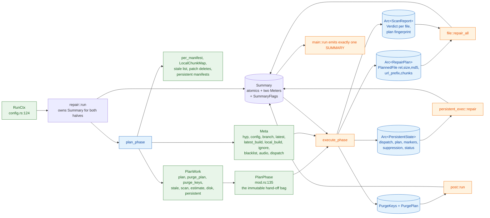

**The one shared counter object** (`app/report/src/summary.rs:48`): `files_total`,
`files_skipped`, `files_repaired`, `files_failed`, `download: Meter`,
`deleted_extra_bytes`, `write: Meter`, `flags`, `stopped_by`, fail-fast/abort flags,
RAM reservation, `files_inplace`, `files_temp`, `kept_bytes`, check damage tally.
Every phase writes into the same `Summary`; only `main` renders it.

---

## 5. L2 — `plan_phase` in full

`src/repair/mod.rs:199-292`. Steps P0–P5. Timed phases: `metadata`, `manifest`,
`plan`, `scan`, `publish` (`app/report/src/phase.rs:11`).

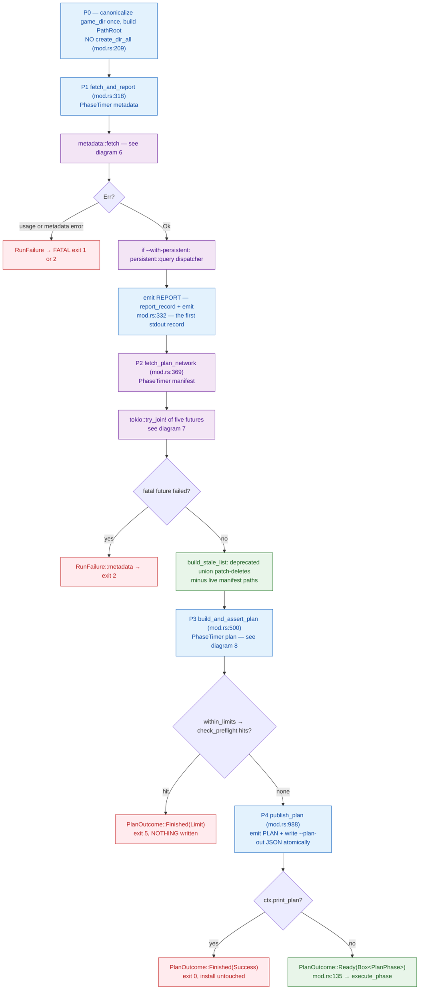

---

## 6. L2 — `metadata::fetch`: two HYP waves plus local reads

`src/repair/phases/metadata.rs:240`. Produces `Meta` (`metadata.rs:31`). Read-only.
The deprecated list is **not** fetched here (it belongs to the plan-phase fan-out).

```mermaid
sequenceDiagram
    autonumber
    participant PP as plan_phase
    participant MD as metadata::fetch
    participant BLK as spawn_blocking_traced (local disk)
    participant H as HypClient (HYP JSON API)

    PP->>MD: fetch(ctx, game_dir)
    MD->>H: hyp_client_for(ctx) — flag > GIRPR_*_BASE > production
    MD->>BLK: util::read_game_version(config.ini)
    Note over BLK: absent = fresh install; unreadable = RunFailure::usage (1)

    rect rgb(243,229,245)
    Note over MD,H: WAVE 1 — settle_primary(config, branch)
    MD->>H: game_config() → get_node launch_configs
    MD->>H: game_branch() → get_node game_branches
    H-->>MD: GameConfig + GameBranchPackage
    MD->>MD: validate biz_mismatch → metadata error (2)
    MD->>MD: validate default_download_mode == DOWNLOAD_MODE_CHUNK → usage (1)
    MD->>MD: clean_config_dir: audio scan/cache/res dirs → '/' form, containment checked
    end

    MD->>BLK: read_ignore_categories + read_blacklist + resolve_effective_audio
    Note over BLK: explicit --audio wins; invalid audio under active scope that hides scan file → usage (1)

    rect rgb(243,229,245)
    Note over MD,H: WAVE 2 — settle_primary(latest build, local build)
    MD->>H: chunk_build(branch, None) → getBuild latest
    MD->>H: chunk_build(branch, Some(local_version)) → getBuild local (best effort)
    H-->>MD: ChunkBuild(latest) + Option&lt;ChunkBuild(local)&gt;
    MD->>MD: latest tag_mismatch → metadata error (2)
    MD->>MD: local tag mismatch or failure → None, warn, "full-fetch fallback"
    end

    MD-->>PP: Meta { hyp, config, branch, latest, latest_build,<br/>local_build, local_version, ignore, blacklist, audio, dispatch: None }
    PP->>PP: emit REPORT record (first stdout line)
```

---

## 7. L2 — `fetch_plan_network`: five-way fan-out

`src/repair/mod.rs:369-447`. One `reqwest::Client` and one `ManifestBudget`
(`crates` semaphore, `app/fetch/src/sophon/mod.rs`), so joined fan-outs cannot double
the peak decoded-manifest memory.

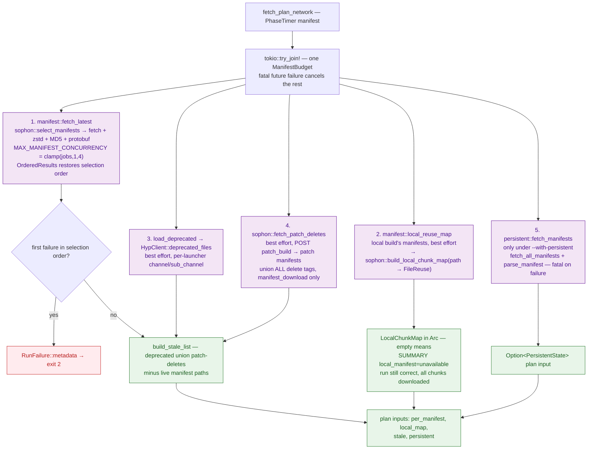

**Manifest decode gate** (`app/fetch/src/sophon/stream.rs:66`): resolve `url_prefix`,
validate blob id (reject `:`, `/`, `\`, `..`, `?`, `#`), GET with 5 attempts and jittered
backoff, check decoded size (64 MiB cap) and MD5 (case-insensitive), then
`prost::Message::decode`. The upstream field is misspelled `chuncks` (tag 1) — byte-critical,
never "fix" it (`crates/proto/src/lib.rs`).

---

## 8. L2 — `build_and_assert_plan`: plan, scope, scan, ceilings

`src/repair/mod.rs:500-698`. Nothing is written here.

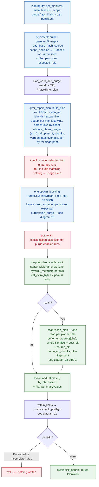

`--scan` is the only way to make the estimate exact: it resolves the write path
(temp / discard / in-place) and the salvage direction, so chunks that direction
overwrites are not counted as downloads. Without it the figure is an upper bound.

---

## 9. L2 — `execute_phase` in full

`src/repair/mod.rs:1069-1218`. Exact internal numbering 5 → 7. Everything below may write.

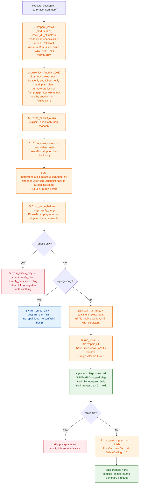

---

## 10. L2 — Files-cleanup: `plan_purge` → `apply_purge`

`src/repair/purge.rs`, values from `app/repair-plan/src/purge_values.rs`. One cleanup
function called twice (before and after repair), planned fully before the first delete.

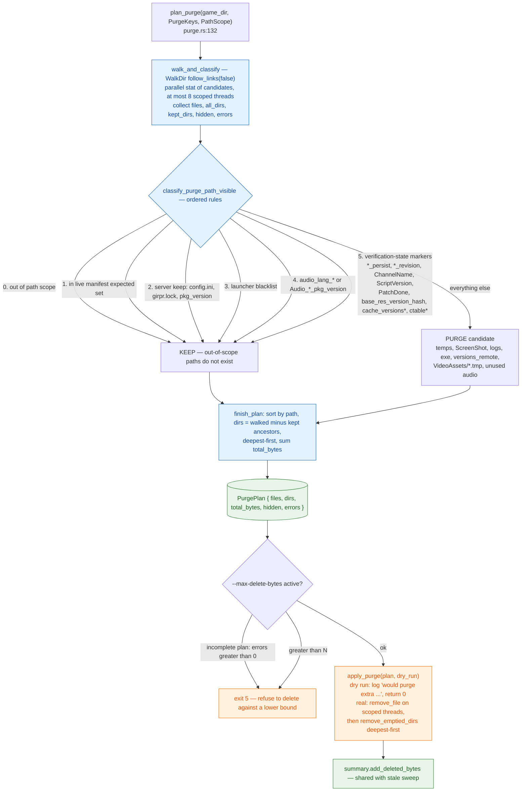

The `purge-after` pass re-plans so repair-created `*_tmp` files are counted, and in a dry
run it lists only candidates the before pass did not name.

---

## 11. L2 — Resource ceilings: refusal vs hard stop

`src/repair/scope/{mod,limits,ledger}.rs`. Two separate tiers: **path scope** answers
*which paths exist*; **resource ceilings** answer *how much work*.

```mermaid
stateDiagram-v2
    classDef exit fill:#ffebee,stroke:#c62828,color:#b71c1c
    [*] --> Parsed: --max-* flags parsed into Limits
    Parsed --> Filtered: build_plan applies --include / --exclude first
    Filtered --> Preflight: Limits::check_preflight(Preflight)
    Preflight --> Refused: Exceeded or IncompletePurge
    note right of Refused
        exit 5, SUMMARY limited=1
        nothing written: no dir created,
        no _tmp opened, no file deleted
    end note
    Refused --> [*]

    Preflight --> Armed: no hit -> install_run_limits
    Armed --> Live: reserve_* charges meter BEFORE the write
    Live --> Settled: settle_* validates; live and settled figures
    Live --> Stopped: live or settled crosses a ceiling
    Stopped --> Reported: apply_run_flags -> flags.stopped = flag
    note right of Reported
        exit 5, SUMMARY stopped=--max-write-bytes etc.
        work already done stays in place;
        next run re-verifies and continues
    end note
    Reported --> [*]
    Settled --> Done: post-phase delete ceiling re-checked by check_delete
    Done --> [*]
```

**The meters** (`app/report/src/ledger.rs:128`): a byte is *live* the moment it is
committed and *settled* once validated. `--max-download-bytes` and `--max-write-bytes`
bound live traffic/disk; `--max-verified-*` bound the settled figures. Each pair is
reported in `SUMMARY` (`download_bytes` / `download_bytes_spent`, `write_bytes` /
`write_bytes_spent`) so the difference is visible waste.

---

## 12. L2 — The `--with-persistent` tier

`src/repair/persistent.rs` (plan half: query, verify, plan, guard) and
`src/repair/persistent_exec.rs` (execute half: prerequisites and full-file bytes).
Without the flag, no dispatcher or persistent request is made and all outputs stay byte-identical.

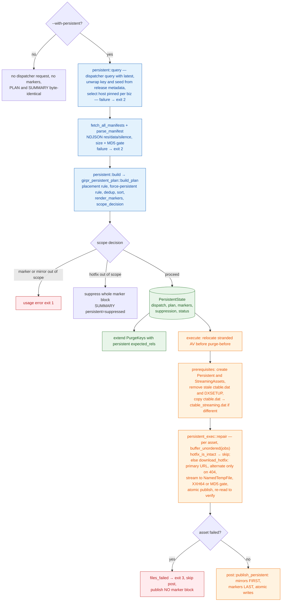

**Post order under the flag**: audio move → cleanup-after → mirrors → full marker
block → `config.ini` bump last. A failed persistent file, a delete ceiling, or a
suppressed run withholds the whole marker block and therefore the version claim.
`--check-only` under the flag also verifies every persistent file, every mirror body
and every marker value; any mismatch is damage (exit 4).

---

## 13. L2 — Post-phase and the final `config.ini` bump

`src/repair/phases/post.rs:55-154`. Load-bearing order: audio move → purge-after →
publish persistent → bump `config.ini` **last**.

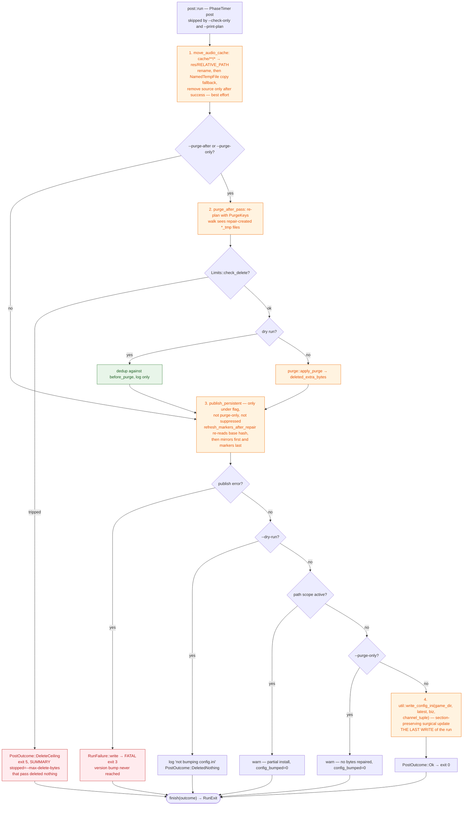

The `config.ini` update forces `game_version`, `game_biz`, `channel`, `sub_channel`, `cps`;
preserves `sdk_version`; drops comments; sorts keys; creates `[General]` if missing.

---

## 14. L2 — Stdout record stream and the log channel

`app/report/src/{record,emit,summary}.rs`. Stdout is a record stream with a fixed order;
tracing diagnostics go to stderr and the log file, never to stdout.

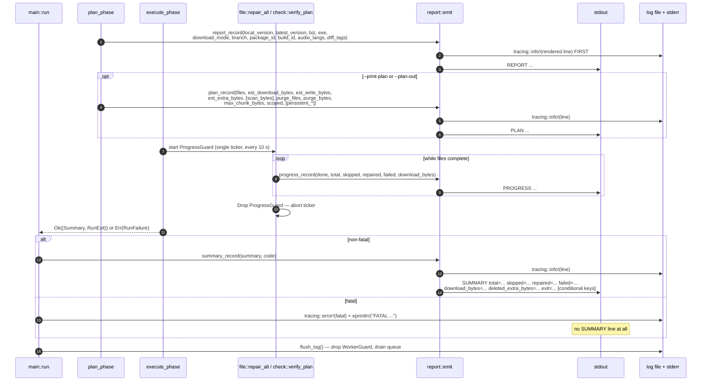

Conditional keys appear **only** when their flag is active, in a fixed tail order:
`limited, scoped, config_bumped, plan_files, plan_download_bytes, download_bytes_spent,
write_bytes, write_bytes_spent, repair_mode, inplace, temp, kept_bytes, ram_bytes,
damaged_chunks, purge_errors, purge_hidden, stopped, local_manifest, persistent,
persistent_files, persistent_repaired, persistent_failed, persistent_base_hash`.

---

## 15. L3 — Per-file repair: complete decision flow

`src/repair/file/mod.rs:344` (`repair_all`) → `join_file_tasks` → `file_task` →
`repair_one_file` (`mod.rs:641`). At most `jobs` files in flight; chunks strictly
sequential per file. Each whole task runs with `Handle::block_on` on Tokio's blocking pool.

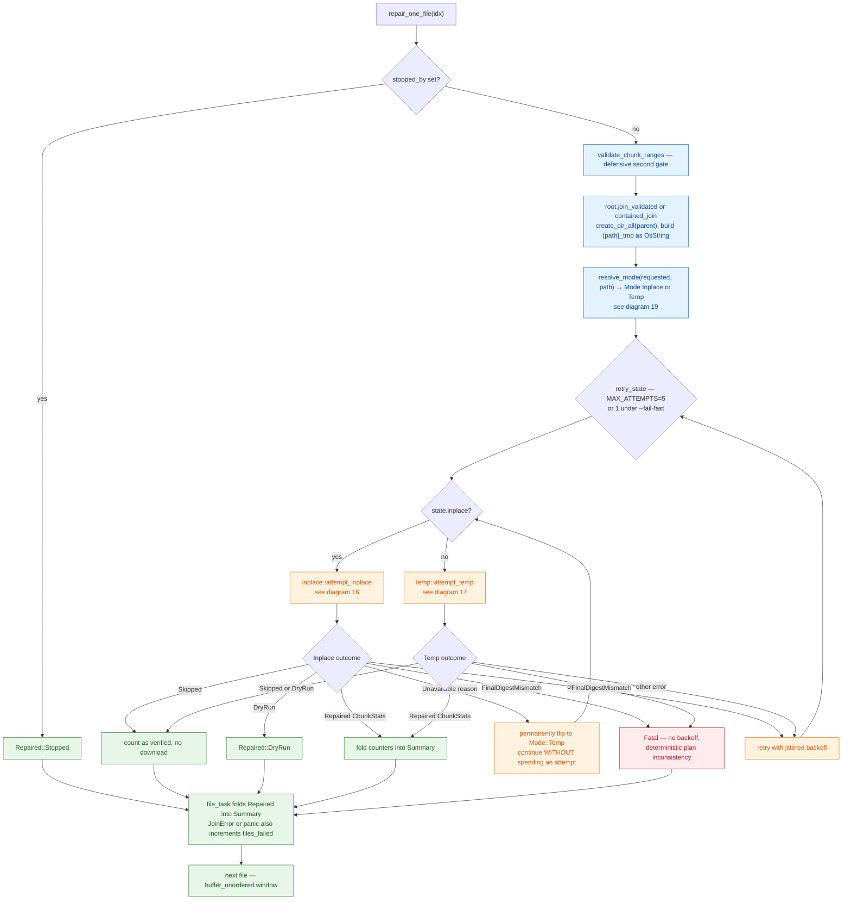

**The invariant**: every byte written lands in a region that was **already wrong at the
moment of the write**, and the whole-file MD5 decides whether the file is good. A
downloaded chunk cannot be hash-gated before it lands, so the gate is structural, not hopeful.

---

## 16. L3 — In-place path internals and the two tiers

`src/repair/file/inplace.rs:90`. No `_tmp` is created; peak extra disk is the file's
**growth**. Two tiers produce the same file with different reuse/direction.

```mermaid
flowchart TD
    classDef exec fill:#fff3e0,stroke:#ef6c00,color:#e65100
    classDef plan fill:#e3f2fd,stroke:#1565c0,color:#0d47a1
    classDef data fill:#e8f5e9,stroke:#2e7d32,color:#1b5e20

    START["attempt_inplace_inner"] --> SRC["reuse::sources_for → Source offsets in the SAME file<br/>scan_ranges → dest_ranges, source_ranges, source_owner"]
    SRC --> OPEN["mode::open_inplace — open_rw(read+write, no truncate),<br/>clear_readonly on failure; still failing → Unavailable"]
    OPEN --> SCAN["open_and_scan — ONE read via util::scan_reader<br/>whole-file MD5 + dest_ok + source_ok"]
    SCAN --> SKIP{"len == size and md5 == planned md5?"}
    SKIP -->|yes| DONE["Inplace::Skipped — count as verified"]
    SKIP -->|no| DISCARD{"--repair-mode discard?"}
    DISCARD -->|yes| DIS["discard_target: delete and recreate the target,<br/>use Scan::absent — AFTER the skip check"]
    DISCARD -->|no| BAD["plan_bad_chunks: chunks where !dest_ok[i]"]
    DIS --> BAD
    BAD --> TRIM["trim_dead_tail — eager set_len only when no plan source<br/>reaches past target size; else deferred to the end"]
    TRIM --> TIER{"choose_tier: moving payload vs --max-ram-bytes"}
    TIER -->|"fits (or size 0: corruption repair)"| STAGED["Tier::Staged<br/>stage_sources re-hashes each captured slice (TOCTOU guard)<br/>RAM payload, extra disk 0, write ASCENDING"]
    TIER -->|"does not fit, or budget 0"| ORDERED["Tier::Ordered<br/>salvage_order_refs: source survives iff<br/>ascending r >= o, descending r <= o<br/>ties go ascending; extra disk 0, RAM 0"]
    STAGED --> PATCH["patch_chunks<br/>staged → write_at<br/>disjoint downloads → window_download_chunks (window 4)<br/>otherwise write_downloaded_chunk<br/>copy_within for ordered salvage<br/>zero_fill gaps, then set_len(file.size)"]
    ORDERED --> PATCH
    PATCH --> VERIFY["verify_and_retry → girpr_chunk_verify::verify_in_place<br/>fresh full read"]
    VERIFY --> VM{"md5 matches?"}
    VM -->|yes| REPAIRED["repaired_inplace — log chunks_total, kept, reused,<br/>downloaded, download_bytes, final_md5"]
    VM -->|no| REDO["run_still_bad_chunks: re-read to name culprit,<br/>redo ONLY those chunks, then read_after_redo"]
    REDO --> RM{"still mismatched?"}
    RM -->|yes| FAIL["FinalDigestMismatch — counted as failed, continue run"]
    RM -->|no| REPAIRED

    class OPEN,SCAN,TRIM plan
    class DIS,BAD,STAGED,ORDERED,PATCH,VERIFY,REDO exec
    class DONE,REPAIRED data
    class FAIL exit
```

**Resume**: in-place resumes by **verification**. There is no artefact — the scan finds
the chunks already correct where they belong, so the next run rewrites only the rest and
cannot inherit a corrupt prefix. No rollback is needed.

---

## 17. L3 — Temp path internals and resume-by-length

`src/repair/file/temp.rs:28` (`attempt_temp`). The target is **never modified** until the
final atomic rename. Peak extra disk is the whole file.

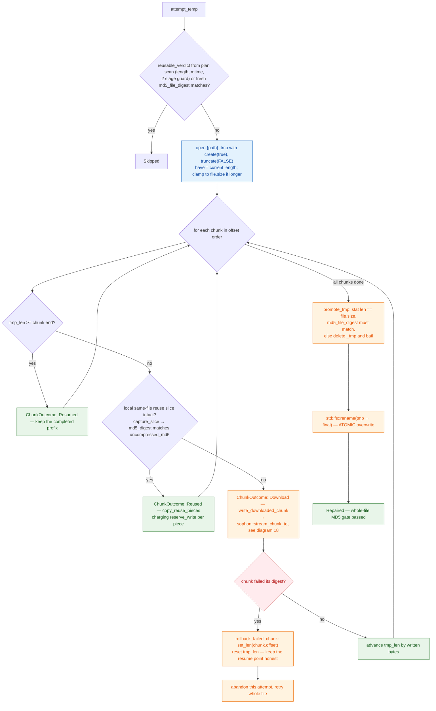

**Resume**: temp resumes by **length**. A chunk that fails its digest is rolled back to
its offset, so every retained byte was digest-checked when written and the resume point
is honest. A target that cannot be opened in place is written this way, loudly
(`Inplace::Unavailable` → permanent `Mode::Temp`, no attempt spent).

---

## 18. L3 — Streamed chunk fetch, decode and digest gate

`app/fetch/src/sophon/stream.rs:443` (`stream_chunk_to`). Only the network receive is
async; zstd decode and sink writes are synchronous, so the caller polls from a blocking
context. The chunk is never resident as a whole.

```mermaid
sequenceDiagram
    autonumber
    participant W as writer (inplace or temp)
    participant SF as stream_chunk_to
    participant T as try_stream_chunk (5 attempts)
    participant H as HashingWriter
    participant Z as zstd Decoder (streaming)
    participant N as CDN URL prefix / chunk id

    W->>SF: ChunkFetch { url_prefix, id, expected size, consumed, sink }
    SF->>SF: validate id, join_url(prefix, id), reserve compressed_size
    loop retry on 408 / 429 / 5xx only; 404 is final
        T->>N: GET {chunk_prefix}/{id}
        N-->>T: response body (zstd-compressed chunk)
        T->>H: wrap sink
        loop each received piece
            H->>H: enforce decoded-size ceiling BEFORE forwarding
            H->>Z: write compressed piece
            Z-->>H: decoded pieces
            H->>W: sink.write(decoded piece) — writes at chunk offset immediately
            W->>W: reserve_write per piece
            H->>H: hash only accepted bytes
        end
        T->>Z: dec.finish() — require a complete zstd frame
        T->>T: consumed += compressed bytes across ALL attempts
        alt digest.bytes == expected and digest.md5 matches uncompressed_md5
            T-->>SF: ChunkDigest ok
        else content mismatch
            T-->>SF: StreamError::Content → Fatal
        end
    end
    SF->>W: settle_reservation(real consumed) — not the reserved upper bound
    W->>W: note_write — settle the settled counter
    Note over W: digest known only after the LAST byte landed;<br/>the whole-file MD5 is the real gate
```

**Retry policy** (`app/fetch/src/retry.rs`): jittered exponential backoff, 5 attempts.
Only `408`/`429`/`5xx` are retried; a 404 on a chunk is asked once because blob ids come
from `getBuild` and are published atomically.

---

## 19. L4 — Write-mode resolution

`app/repair-policy/src/lib.rs:81` (`resolve_mode`) — one rule, shared by the writer, the
disk estimate and the download estimate so they cannot disagree.

```mermaid
flowchart TD
    classDef plan fill:#e3f2fd,stroke:#1565c0,color:#0d47a1
    classDef exec fill:#fff3e0,stroke:#ef6c00,color:#e65100
    classDef data fill:#e8f5e9,stroke:#2e7d32,color:#1b5e20

    START["--repair-mode = auto | inplace | temp | discard<br/>default auto"] --> Q{"requested == Temp?"}
    Q -->|yes| T["Mode::Temp — assemble in {path}_tmp,<br/>atomic rename, target never modified"]
    Q -->|no| META{"symlink_metadata(path)"}
    META -->|Ok and is_file| I["Mode::Inplace — write only wrong bytes,<br/>no _tmp, peak extra disk = file growth"]
    META -->|Err (missing)| I
    META -->|Ok but dir or symlink| T
    I --> D{"requested == Discard?"}
    D -->|yes| DISC["resolve to Inplace, but discard_if_requested<br/>deletes and recreates the target first:<br/>0 extra disk when already full size, full download"]
    D -->|no| I2["normal in-place: corruption repair writes 0 bytes moved;<br/>version upgrade uses Staged or Ordered tier"]
    T --> OPEN{"open_inplace actually succeeds?"}
    OPEN -->|no| T2["Inplace::Unavailable → permanent Mode::Temp<br/>loudly, no attempt spent"]
    OPEN -->|yes| I

    class START,Q,META,D plan
    class T,DISC,I2,T2 exec
    class I data
```

`src/repair/file/mode.rs` holds only the **open helpers** (`open_inplace`, `open_rw`,
`clear_readonly`); the *policy* lives in `app/repair-policy`. `SUMMARY` carries a
conditional `repair_mode=`, `inplace=`, `temp=`, `kept_bytes=` group only when
`--repair-mode` was passed.

---

## 20. L4 — Module / crate dependency map

The binary depends on acyclic leaves; no report key or exit code is shared between
programs. `girpr` is the only default workspace member; `gircap`, `girsync`,
`sled2redb`, `cache-json` are dev tools.

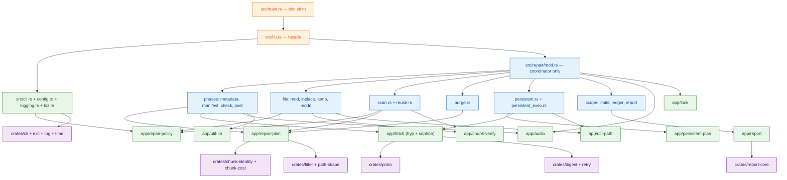

---

## 21. L4 — Resume state machine — same install, next run

The two write modes resume differently, each in the way that suits its write direction.
Every resume is safe because the whole-file MD5 gates the version claim.

```mermaid
stateDiagram-v2
    [*] --> Interrupted: a run stops mid-flight (ceiling, failure, kill)

    Interrupted --> ReScanI: mode auto or inplace — no artefact
    ReScanI --> IntactI: next run re-reads each planned file once
    IntactI --> RewriteI: chunks correct where they belong stay
    RewriteI --> GateI: rewrite only the wrong chunks
    GateI --> ConfigBump: final whole-file MD5 passes

    Interrupted --> KeepPrefixT: mode temp — open {path}_tmp without truncation
    KeepPrefixT --> ResumeT: tmp_len >= chunk end means already done
    ResumeT --> DigestFailT: a chunk fails its decoded MD5
    DigestFailT --> RollbackT: set_len(chunk.offset), reset tmp_len
    RollbackT --> ResumeT
    ResumeT --> PromoteT: len == size and md5(tmp) == planned md5
    PromoteT --> AtomicRenameT: std::fs::rename tmp to final
    AtomicRenameT --> ConfigBump

    ConfigBump --> [*]: config.ini advanced only if EVERY planned file verified

    note right of ReScanI
        in-place: no rollback, a corrupt prefix
        cannot be inherited; next scan finds it
    end note
    note right of RollbackT
        temp: every retained byte was digest-checked
        when written; the resume point stays honest
    end note
```

**Rerun is safe** overall: intact files are skipped, and the rest are re-verified.
`--check-only` performs only step 1 for every file (presence, length, MD5) and writes
nothing; a malformed manifest chunk range is refused at plan time (exit 2) so it cannot
report such a file intact.

---

## 22. L3 — `--check-only` verification detail

`src/repair/phases/check.rs:60` (`verify_plan`) and `check.rs:278` (`verify_persistent`).
The check phase is an early return in the execute half, before any download or write.

```mermaid
flowchart TD
    classDef plan fill:#e3f2fd,stroke:#1565c0,color:#0d47a1
    classDef data fill:#e8f5e9,stroke:#2e7d32,color:#1b5e20
    classDef exit fill:#ffebee,stroke:#c62828,color:#b71c1c

    START["run_check_only (mod.rs:1411)"] --> TIMER["PhaseTimer check + ProgressGuard ticker"]
    TIMER --> LOOP["for each planned file, spawn_blocking,<br/>buffer_unordered(jobs) — resolve root.join_validated"]
    LOOP --> SRC{"--scan verdict available<br/>and plan fingerprint matches?"}
    SRC -->|yes| USEV["DigestSource::Scanned — reuse the plan-phase MD5,<br/>but re-stat presence and length"]
    SRC -->|no| USER["DigestSource::Read — util::md5::md5_file_digest on current bytes"]
    USEV --> GATE{"check_one: presence → length → MD5"}
    USER --> GATE
    BAD["CheckFailure: PathEscaped, Unreadable,<br/>Absent, Size, Md5 or Read"]
    GATE -->|"absent or unreadable"| BAD
    GATE -->|"size differs"| BAD
    GATE -->|"MD5 differs"| BAD
    GATE -->|all match| GOOD["CheckOutcome::clean"]
    BAD --> FOLD["record_check: files_failed += 1"]
    GOOD --> FOLD2["record_check: files_skipped += 1"]
    FOLD --> WARN["one single warn site emits every failure shape"]
    FOLD2 --> PERS{"--with-persistent?"}
    WARN --> PERS
    PERS -->|yes| PV["verify_persistent: each asset via hotfix_is_intact,<br/>each mirror via verify_manifest_bytes,<br/>each marker byte-for-byte against refresh_markers_after_repair"]
    PERS -->|no| TALLY
    PV --> TALLY["publish_check_damaged_chunks — measured zero differs from never ran"]
    TALLY --> Q{"any bad item?"}
    Q -->|no| X0["RunExit::Success — exit 0, writes nothing"]
    Q -->|yes| X4["RunExit::CheckFailed — exit 4, writes nothing"]

    class TIMER,LOOP,SRC,USEV,USER,GATE plan
    class FOLD,FOLD2,WARN,PERS,PV,TALLY data
    class X0,X4 exit
```

**Note**: with `--scan`, the plan-phase scan already hashed each file, so a same-length
content change *after* the scan can be reported intact. A fresh check of current bytes
must omit `--scan`.

---

## One-line summary of the whole atlas

```
main shim → run() → [PLAN: metadata → REPORT → 5-way manifest fan-out → build_plan
→ scan → ceilings → PLAN] → [EXECUTE: mkdir → lock → audio → stale sweep → purge-before
→ check | purge-only | persistent → per-file repair (in-place tiers or temp resume)
→ post: audio → purge-after → mirrors → markers → config.ini LAST] → SUMMARY → flush → exit code
```

Sources: `README.md` (action graph and machine contracts), `docs/02-repair-chunk-spec.md`,
`docs/03-repair-rust-implementation-plan.md`, and the Rust sources under `src/`,
`app/`, and `crates/` at the paths and line numbers named in each diagram.
