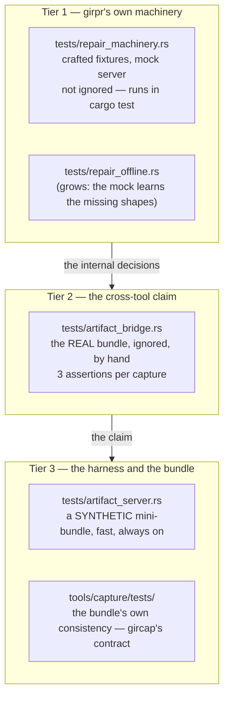

# Artifact test scope — getting the bundle tests back to what they were for

**Status: plan. Nothing here has landed yet.** It says what the
artifact-bridge suite became, why it drifted, what it should become, and the
order the work lands in.

**Scope:** the `girpr` package's test tree, and `tools/capture` (`gircap`),
which produces the bundle. The bundle format itself is in scope, because the
format grew fields that belong to `girpr` and not to a repair tool.

**Backwards compatibility is not required.** Not for `girpr`, not for `gircap`,
not for the bundle format. The bundle's schema version bumps, and a v1 bundle
is refused with a message that says so.

---

## 0. This document is temporary, and nothing may point into it

**This document is deleted when the work is done.** Its content is folded into
the documents that own it — `docs/06-artifact-bridge-spec.md` (what the bundle
is for, and what the harness does), `girpr`'s `README.md` (*Testing*), and on
the `gircap` side `tools/capture/docs/00-spec.md` (the class set and the
assertion ids), `tools/capture/docs/01-artifact-schema.md` (the patchmap's
fields) and `tools/capture/README.md` (the bundle's size) — and this file goes
away with the last milestone. It is the plan of record **during** the work, not
a document that ships. §14 has the table, item by item.

**Nothing may point into it.** Not from a source comment, not from a test, not
from a document, not from a doc's "see also", and not from a commit message's
body. No `docs/09 §N`, no `M0`–`M9`, no "as the artifact plan says". The
milestone ids and the section numbers here are **work coordinates, not
citations**: they are for the commits of this work and for nothing else.

The reason is the house's own third fold (`818f8ee`, *merge the option/plan
pairs into two specs, and drop the archaeology*), whose stated job was to
remove *"section pointers into the deleted plans, [and] milestone references
(M0-M7)"* from comments and docs across the refactor scope. A plan that
leaves pointers behind is not a temporary document; it is a permanent
dependency on a file that is going to be deleted, and the day it is deleted
every one of those pointers becomes a broken link that nobody notices until a
reader follows it.

So the rule for the agent doing this work is:

> **Everything this plan says must end up somewhere that does not need this
> plan.** When a change lands, the shipped tree must describe the change
> **without** this file. If a sentence in a source comment, a test, a doc or
> a commit message only makes sense with this file open, that sentence is
> wrong and has to be rewritten, not pointed.

**The one permitted pointer** is the `README.md` docs table's row for this
file, which is how the house marks a plan that is in flight (the streaming
zstd decode's row sat there until `bb54887` removed it). It is a *row in a
list of documents*, not a citation, and **M8 deletes it with the file**.

The fold (§14) is where all of this is checked, and it is the last commit.

---

## 1. The finding, in one paragraph

`tests/artifact_bridge.rs` exists to prove one thing: **`girpr`'s output is
identical to what another repair tool computes, whatever `girpr`'s internal
implementation happens to be.** `gircap` computes the patch independently — its
own manifest diff, its own reuse scoring, its own arithmetic — and records the
ground truth in the bundle; `girpr` is then run against the same inputs and its
result is compared. That is a **cross-tool** claim, and it is **three
assertions** per capture: the patched bytes, the set of chunk ids that had to
be fetched, and the byte total.

What the suite actually became is something else: **26 cases, 79 `girpr`
subprocess runs, and roughly 12 GiB of fixture copying**, of which only a
handful of cases assert the cross-tool claim. The rest assert `girpr`'s
*internal* machinery — which tier it picked, which direction it wrote in,
whether it trimmed eagerly, whether a RAM reservation was refused — against a
bundle whose schema had to grow a `repair` block and an `expectations.summary`
block to carry those answers. The internal decisions are **not shared with any
other repair tool** and they are **not what the bundle was captured to prove**;
they are exactly the decisions a crafted fixture expresses better, faster and
without a 696 MB download.

---

## 2. What the suite became

### 2.1 The inventory

26 `#[tokio::test]`s, all `#[ignore]`d. Grouped by what they actually exercise:

| group | cases | exercises | belongs to |
|---|---|---|---|
| **D** | 16 | `girpr`'s repair machinery: the tier, the direction rule, the trim outcome, the refused RAM reservation, the in-place re-verify, the discard mode, the temp-vs-in-place differential | `girpr` — offline, crafted |
| **B** | 7 | the replay **server**: the `url_prefix` rewrite, the manifest-id routing, the `build_id` invariant, the not-found shape replay | the harness itself |
| **C** | 2 | the **bundle's** own metadata: `MANIFEST.json`'s matrix vs `patchmaps/*.json` | `gircap` |
| **A** | 1 | bundle **discovery**: `gircap list` vs a directory scan | `gircap` |

Only the **D** group is about `girpr` at all, and only a fraction of **D** is
about the *cross-tool* claim rather than about `girpr`'s internals.

### 2.2 Which of the D cases are cross-tool

A cross-tool case asserts that `girpr` fetched **exactly** the chunks the
independent computation says it must fetch, and produced **exactly** the
reference bytes. That is a property of the *patch*. It is **not** a property of
the strategy that produced the patch.

| case | cross-tool? | why |
|---|---|---|
| `one_capture_patches_to_the_new_version` | **yes** | the whole claim, on one capture |
| `capture_identical_is_planned_and_skipped` | partly | "nothing was fetched" is cross-tool; "the file was not touched" is `girpr`'s |
| `capture_zero_reuse_single` / `_multi` | partly | the fetch set is cross-tool; the path-with-a-space glob is `girpr`'s |
| `capture_kept_in_place_reuses_the_nine_it_can` | partly | the fetch set is cross-tool; "the in-place run writes strictly fewer bytes than the temp one" is `girpr`'s |
| `capture_added_is_downloaded_in_full` | **yes** | the file is created whole; the fetch set is the whole file |
| `capture_removed_is_purged_by_the_cleanup` | **yes** | the file is gone; the purge counters are `girpr`'s, the *decision* is cross-tool |
| `capture_moved_ascending` / `_descending` / `_mixed` | **no** | the *direction* is a strategy. The fetch set and the output bytes are the same kind of thing as any other partial-reuse file |
| `capture_trim_eager` / `_deferred` | **no** | the *trim* is a strategy. The output bytes and the fetch set do not depend on it |
| `the_ordered_tier_downloads_exactly_the_patchmap_total` | **no** | the ordered tier is `girpr`'s tier |
| `a_ram_budget_too_small_for_the_payload_degrades_to_the_ordered_tier` | **no** | entirely `girpr`'s |
| `the_discard_mode_downloads_the_whole_file_and_still_produces_it` | **no** | entirely `girpr`'s |
| `the_in_place_path_re_verifies_and_continues` | **no** | entirely `girpr`'s |

So **three** of the 26 cases state the cross-tool claim outright, and three or
four more state a part of it. **The other nineteen** assert things that no
other repair tool shares, that the bundle was never captured to prove, and that
a 128-byte crafted fixture states better.

### 2.3 The leak into `gircap`

The bundle schema grew fields that are `girpr`'s own vocabulary, per flag:

| field | what it is | who reads it |
|---|---|---|
| `expectations.summary.damaged_chunks` | `girpr`'s `SUMMARY damaged_chunks` (`--scan`) | the bridge only |
| `expectations.summary.inplace` / `.temp` | `girpr`'s `SUMMARY inplace` / `temp` (`--repair-mode`) | the bridge only |
| `expectations.summary.kept_bytes` | `girpr`'s `SUMMARY kept_bytes` (`--repair-mode`) | the bridge only |
| `expectations.summary.ram_bytes_ordered` | `girpr`'s `SUMMARY ram_bytes` under `--max-ram-bytes 0` | the bridge only |
| `expectations.summary.ram_bytes_staged` | `girpr`'s `SUMMARY ram_bytes` under a big budget | the bridge only |
| `expectations.summary.write_bytes` | `girpr`'s `SUMMARY write_bytes` (`--max-write-bytes`) | the bridge only |
| `repair.direction` | `girpr`'s `repair::reuse::salvage_order` tie-break | the bridge only |
| `repair.keeps_ascending` / `.keeps_descending` | `girpr`'s `repair::reuse::survives` | the bridge only |
| `repair.trim` | `girpr`'s eager/deferred trim branch | the bridge only |
| `repair.payload_bytes` | `girpr`'s staged-tier payload | the bridge only |
| `repair.mode` | `girpr`'s default write mode | **nobody, in either tool** |

`girpr` reports **one** `ram_bytes` key; the bundle states it **twice**, once
per flag, and the bridge compares each against a different run. That is not a
bundle fact. That is `girpr`'s CLI encoded in a foreign schema, and it is the
sharpest single sign of the drift.

The same shape appears in the **class set**. The eleven classes are a
partition over `girpr`'s internal decisions D1–D6 (skip / kept-copied-fetched /
tier / direction / trim / growth):

| class | over | cross-tool relevant? |
|---|---|---|
| `identical` | D1 | **yes** — nothing to fetch |
| `zero_reuse_single`, `zero_reuse_multi` | D2 | **yes** — everything fetched |
| `kept_in_place` | D2 | **yes** — a strict subset fetched |
| `moved_ascending`, `moved_descending`, `moved_mixed` | **D4** | **no** — the *direction* is a strategy. All three have the same kind of fetch set: a strict subset |
| `trim_eager`, `trim_deferred` | **D5** | **no** — the *trim* is a strategy. Neither changes the fetch set or the output |
| `added` | D1 | **yes** — the file is new |
| `removed` | D1 | **yes** — the file is gone |

Five of the eleven classes exist to hand the bridge one real file per
**internal** shape, and three of them (`moved_mixed` at a 290 MB fixture,
`moved_descending` at 100 MB, `trim_eager` at 22 MB) are the most expensive
files in the bundle.

### 2.4 The measured cost

Measured on this machine (4 CPUs, NVMe, release build, the reference bundle
`artifacts/hk4e_global/7.0.0__7.1.0/20261020T154810Z`):

| | measured |
|---|---|
| the whole `#[ignore]`d suite, **release** | **233 s** (26 passed) |
| the whole `#[ignore]`d suite, **debug** | ~21 min (the figure `docs/06` §3.1 quotes) |
| the offline suite (`cargo test -p girpr`), release | **21.5 s** (147 unit + 81 integration) |
| one case (`capture_identical_is_planned_and_skipped`), release | **16.5 s** — to assert `skipped=1, download_bytes=0` |
| `gircap verify` (the precondition, run 23×) | included above |

The structural cost, which does not depend on the build profile:

| | today |
|---|---|
| bundle on disk | **696 MB** (324 files) |
| `game/` fixture | 222 912 400 B (213 MiB) |
| scratch copies per repair capture | **3** (the run + the differential's two) → 638 MB written |
| scratch copies across the suite | **59** → **≈ 12.25 GiB** written and re-read |
| manifests fetched | **4 per `girpr` run** (`game` + `en-us`, × 2 tags) = 19 956 220 B |
| manifests across the suite | 79 runs × 19.96 MB ≈ **1.58 GB** of loopback |
| `girpr` subprocess runs | **79** (12 `--print-plan` pre-passes + 67 real) |
| `gircap` subprocess runs | **50** (27 `gircap list` + 23 `gircap verify`) |

Three numbers carry the argument:

1. **638 MB of disk writes to assert `skipped=1`.** The copy is of the *whole*
   213 MiB fixture, because the differential wants a second copy and the tree
   diff wants a baseline over every path in it.
2. **19.96 MB of manifests before the tool can plan a single file.** The
   `game` archive is 9 MB per tag and there is no flag to skip it.
3. **`moved_mixed` alone** — 290 MB of fixture, a 64 MB patch download, four
   runs, and a differential that writes the 146.9 MB file twice — exists to
   observe a *direction tie-break* that a 192-byte fixture states exactly.

### 2.5 How it drifted

The plan that built it (`docs/07-artifact-bridge-implementation-plan.md`, since
folded away) was written entirely around the bundle:

> *"`girpr`'s crate and its test tree. `tools/capture` is named as the input's
> origin and is **not modified, not depended on, not imported**."*

That sentence is where it went wrong, and it was reasonable at the time: the
first case was "run the real binary against a real bundle", and the bundle was
the only thing available that carried real game bytes. Every case after it was
specified as "one more capture shape", because the capture tool could already
emit one file per shape — and the shape list had been derived from `girpr`'s
repair decisions. So the bundle's class set was `girpr`'s decision list, the
bundle's `repair` block was `girpr`'s decision outputs, and the bridge's cases
were `girpr`'s decision branches. The cross-tool claim — the one the whole
apparatus was built for — survived as three assertions inside a 26-case suite
whose other 23 cases and whose entire 696 MB of payload were about `girpr`
talking to itself.

---

## 3. The target shape

Three tiers, each with a different owner and a different cost:



| tier | what it proves | needs the real bundle? | runs in `cargo test`? |
|---|---|---|---|
| **1** — machinery | every internal decision D1–D9, on crafted inputs | **no** | **yes** |
| **2** — cross-tool | `girpr`'s output == the independently computed patch | **yes** | no (`#[ignore]`d) |
| **3** — harness + bundle | the replay server works; the bundle is self-consistent | no (a synthetic mini-bundle) | **yes** |

The rule of thumb:

> **A test belongs in Tier 1 if another repair tool could plausibly do it
> differently. It belongs in Tier 2 if the answer must be the same whatever
> the implementation.**

Tier 2 is the only tier that needs 696 MB of real game bytes, and it needs
them for exactly one reason: the patch has to be computed by something that is
not `girpr`.

---

## 4. The migration map

Every one of the 26 cases, and where it goes. **Nothing is deleted before its
replacement is green** — see §8.

### 4.1 The D cases (16) — `girpr`'s machinery

| case | new home | the crafted shape it needs |
|---|---|---|
| `one_capture_patches_to_the_new_version` | **Tier 2** (kept, narrowed) | — |
| `capture_identical_is_planned_and_skipped` | Tier 1: *an intact file is planned and skipped* | existing — `game/bar.dat` written intact (offline #2 already covers it) |
| `capture_zero_reuse_single_downloads_its_whole_file` | Tier 1: *a file with one chunk and no source* | existing — `game/bar.dat`, damaged (48 B, 1 chunk) |
| `capture_zero_reuse_multi_downloads_its_whole_file` | Tier 1: *a file with several chunks and no source* + *a path with a space* | existing — `game/foo.dat`, damaged (128 B, 2 chunks); **new** — a spaced rel path |
| `capture_kept_in_place_reuses_the_nine_it_can` | Tier 1: *the reuse set is exactly the kept chunks* | existing — `game/foo.dat` with a local manifest (offline #8, #10) |
| `capture_moved_ascending_reuses_the_nine_it_can` | Tier 1: *a uniform downward shift → the ascending order keeps every source* | **new**: a uniform-shift fixture |
| `capture_moved_descending_keeps_every_source` | Tier 1: *a uniform upward shift → the descending order keeps every source* | **new**: a uniform-shift fixture |
| `capture_moved_mixed_keeps_the_larger_half` | Tier 1: *a mixed shift → the order that keeps the larger half* | **new**: a mixed-shift fixture (can be made far more extreme than 7-vs-60) |
| `capture_trim_eager_releases_the_dead_tail` | Tier 1: *the file shrinks and no source reaches past the end → the tail is released first* | **new**: a shrinking fixture |
| `capture_trim_deferred_is_covered_by_the_moved_capture` | Tier 1: *a source reaches past the end → the trim waits* | **new**: a shrinking fixture with a late source |
| `capture_added_is_downloaded_in_full` | Tier 1: *a path absent on disk and present in the manifest* + Tier 2 | existing capability |
| `capture_removed_is_purged_by_the_cleanup` | Tier 1: *a path on disk and absent from the manifest* + Tier 2 | existing capability (offline #58, #70) |
| `the_ordered_tier_downloads_exactly_the_patchmap_total` | Tier 1: *the ordered tier downloads exactly what the direction rule allows* | the uniform/mixed shift fixtures |
| `a_ram_budget_too_small_for_the_payload_degrades_to_the_ordered_tier` | Tier 1: *a refused reservation degrades to the ordered tier and says so* | the shift fixture + `max_ram_bytes` |
| `the_discard_mode_downloads_the_whole_file_and_still_produces_it` | Tier 1: *discard writes the whole file and keeps nothing* | existing (offline #12) |
| `the_in_place_path_re_verifies_and_continues` | Tier 1: *a damaged file is fixed and only the damaged chunk is* | existing (offline #22) |

### 4.2 The `drive_capture` assertions that are pure `girpr`

These are assertions the driver makes on *every* capture, and they are not
cross-tool facts. They move to Tier 1 (several already exist there):

| assertion | already offline? |
|---|---|
| `download_bytes_spent == download_bytes`, `write_bytes_spent == write_bytes` | yes — offline #50, #66 |
| `local_manifest == "ok"` | yes — offline #68 |
| `scoped == 1`, `config_bumped == 0` | yes — offline #26, #70 |
| the plan line's `files` / `scoped` | yes — offline #44, #71 |
| the tree diff: **nothing outside the scope moved** | **no** — needs a multi-file manifest in the mock |
| the trace log's download records agree with the server's request log | **no** — needs `--log-file` coverage |
| `exit == 0`, `summary.exit == 0` | yes |

### 4.3 The B cases (7) — the harness

All seven move to a new **`tests/artifact_server.rs`**: the replay server, with
a **synthetic mini-bundle** rather than the 696 MB one. The `ShadowBundle`
helper already in the bridge is the prototype — it copies only `MANIFEST.json`,
`patchmaps/` and the `api/` bodies (222 KB).

| case | what the mini-bundle needs |
|---|---|
| `the_rewrite_changes_only_the_two_url_prefixes` | two `getBuild` bodies with one manifest each |
| `each_namespace_keeps_its_path_and_gets_its_own_origin` | the same |
| `a_manifest_id_resolves_to_the_field_archive_of_its_own_build` | one carried + one uncarried manifest per build |
| `a_blob_under_the_other_builds_prefix_is_refused` | one carried manifest for the new build |
| `an_unserved_getbuild_tag_replays_the_recorded_not_found` | an `error_shapes.json` with one shape |
| `not_found_is_replayed_from_the_recorded_shapes` | an `error_shapes.json` with all seven |
| `a_bundle_without_recorded_shapes_says_so_instead_of_inventing` | the shadow bundle (already synthetic) |

### 4.4 The C and A cases (3) — the bundle's own consistency

`the_capture_matrix_loads_with_distinct_paths`,
`the_matrix_and_the_patchmaps_agree_in_both_directions` and
`discovery_agrees_whether_it_asks_gircap_or_scans` are **`gircap`'s** contract:
the matrix and the patchmaps must describe each other, and `gircap list` must
agree with a directory scan. They move to `tools/capture/tests/`, where the
bundle is built by the tool's own writers and the assertions cost nothing.

### 4.5 The summary

| from | to |
|---|---|
| 26 `#[ignore]`d cases, 79 `girpr` runs, 12.25 GiB of copies | **6 `#[ignore]`d cases** (Tier 2 — one per patch shape), **~40 new always-on cases** (Tier 1), **~15 new always-on cases** (Tier 3) |

---

## 5. What `gircap` must change

`gircap` is a **capture tool**. Its job is to record the live API's answers and
the ground truth computed from them. Nothing in it should know what `girpr`'s
`SUMMARY` line looks like, and nothing in it should know that `girpr` has
tiers, directions or trims.

### 5.1 The patchmap schema: drop the leak

`patchmaps/<capture_id>.json` keeps what is a fact about the **patch** and
loses what is a fact about **`girpr`**.

**Kept** — the independently computed patch. This is the cross-tool ground
truth and the reason the bundle exists:

| field | why |
|---|---|
| `plan[]` with `decision` (`REUSE`/`FETCH`), `chunk_id`, `target_range`, `source_range`, `compressed_size`, `uncompressed_size`, `uncompressed_md5` | the per-chunk decision, computed by `gircap` from the two manifests. It is what "the same output as another repair tool" is *made of* |
| `totals.{chunks,reuse,fetch,moved,download_bytes}` | the byte total, computed by `gircap`'s own arithmetic |
| `expectations.{result_path,result_md5,absent_after,download_bytes}` | the reference bytes and the reference total |
| `expectations.must_not_fetch` | the REUSE set, as the **negative** assertion. It is derivable from `plan[]`; keeping it explicit is fine, but §5.4 makes `verify` check it against `plan[]` so there is one source of truth |
| `old` / `new` sides, `path`, `matching_field` | the inputs |

**Dropped** — `girpr`'s internals:

| field | dropped because |
|---|---|
| `expectations.summary` (all seven keys) | it is `girpr`'s `SUMMARY` line, per flag. `girpr` reports one `ram_bytes`; the bundle stated it twice, once per flag |
| `repair.direction`, `repair.keeps_ascending`, `repair.keeps_descending` | `girpr`'s `repair::reuse::salvage_order` tie-break |
| `repair.trim` | `girpr`'s eager/deferred trim branch |
| `repair.payload_bytes` | `girpr`'s staged-tier payload |
| `repair.kept`, `repair.moved`, `repair.fetch` | `girpr`'s kept/copied/fetched vocabulary. The patch's own vocabulary is `plan[].decision` |
| `repair.kept_bytes`, `repair.write_bytes` | `girpr`'s write accounting |
| `repair.growth_bytes` | derivable: `new.size - old.size` |
| `repair.mode` | read by nobody, in either tool |

`gircap` keeps computing what it needs to compute — it still needs the
direction and the trim to *verify* its own patch arithmetic (A9, A20) — it
simply stops **publishing** them.

### 5.2 The class set: eleven → six

The classes exist to give the bundle one file per **patch shape**. A patch
shape is a fact about the patch; a strategy is not.

| new class | predicate | the patch shape it covers |
|---|---|---|
| `identical` | `old.md5 == new.md5` | nothing to fetch; the file is already right |
| `no_reuse` | `reused == 0`, `nchunks > 1` | **every** chunk is fetched: the whole file is overwritten |
| `reuse_in_place` | `0 < reused < nchunks`, `moved == 0` | a strict subset is fetched; the reused chunks are already correct where they belong |
| `reuse_moved` | `moved > 0` | a strict subset is fetched; the reused chunks live **elsewhere** in the file and have to be copied |
| `added` | the path is only in the new manifest | the file is created whole |
| `removed` | the path is only in the old manifest | the file is purged |

These six are the patch space's boundary conditions: **nothing** fetched,
**everything** fetched, **a subset** fetched with the reused part already in
place, **a subset** fetched with the reused part moved, a **new** file, and a
**deleted** file. The `nchunks > 1` on `no_reuse` is deliberate: a one-chunk
file is a degenerate patch, and `added` already covers the "create a file
whole" case.

The **dropped** classes are `moved_descending`, `moved_mixed`, `trim_eager` and
`trim_deferred` — all of them **strategy** classes over `girpr`'s D4 and D5.
`moved_ascending` survives, renamed `reuse_moved`: it is the cheapest file
whose reused chunks have moved, which is the shape the name now describes.
The dropped classes' patch shapes are already covered: `moved_descending` and
`moved_mixed` are both `reuse_moved` with a different *direction*, and
`trim_eager` / `trim_deferred` are both a reuse class on a file that happens
to shrink.

The cost effect on the reference pair (`7.0.0` → `7.1.0`), using the class
table in `tools/capture/docs/00-spec.md` §4.1:

| old class | fixture on disk | becomes | stays? |
|---|---|---|---|
| `identical` | 28 B | `identical` | yes |
| `zero_reuse_single` | 16 B | `no_reuse` | folded in |
| `zero_reuse_multi` | 9.9 MB | `no_reuse` | **yes** — the representative one |
| `kept_in_place` | 4.7 MB | `reuse_in_place` | yes |
| `moved_ascending` | 23.8 MB | `reuse_moved` | **yes** — the representative one |
| `moved_descending` | 100.5 MB | `reuse_moved` | **dropped** (same shape) |
| `moved_mixed` | 290.4 MB | `reuse_moved` | **dropped** (same shape) |
| `trim_eager` | 21.8 MB | `reuse_in_place` | **dropped** (same shape) |
| `trim_deferred` | — (covered by `moved_ascending`) | `reuse_moved` | **dropped** |
| `added` | 249 KB | `added` | yes |
| `removed` | 1.7 MB | `removed` | yes |

The bundle's `game/` fixture drops from **213 MiB to ≈ 40 MiB**, and the
bundle from **696 MB to ≈ 200 MB** (the manifests — 41 MB — and the diff
documents do not shrink, and the retained blobs fall with the captures they
belonged to). No loss to the cross-tool claim: every *patch shape* is still
represented, and the dropped captures were distinguished only by **how**
`girpr` gets to the result.

### 5.3 The coverage assertions A21–A23

A21 ("the bundle covers both trim outcomes"), A22 ("both write directions")
and A23 ("a file that grows") exist because the bridge wanted one file per
**internal** shape, and they are **fatal in a capture** — which is why a
budgeted capture that cannot afford `moved_mixed` exits `3` today.

With the class set shrunk they are replaced by assertions over the **patch
shapes**:

| id | was | becomes |
|---|---|---|
| A21 | both trim outcomes | the bundle covers a file with **no** reusable chunk and a file with **some** — both sides of the reuse boundary |
| A22 | both write directions | the bundle covers a file whose reused chunks are **in place** and a file whose reused chunks **moved** |
| A23 | a file that grows | the bundle covers a file that **grows** and a file that **shrinks** |

These are still *coverage* assertions — still fatal in a capture, still a
finding in a `verify` — but they now describe the **patch space**, which is
what a bundle is for.

### 5.4 `verify`: one source of truth

A20 currently re-derives `totals` and `expectations.download_bytes` from
`plan[]`. With `expectations.summary` gone and `must_not_fetch` kept, A20
grows one row: **`must_not_fetch` == the `chunk_id`s of the `plan[]` entries
whose `decision` is `REUSE`**. That keeps the negative assertion honest
without a second source of truth.

### 5.5 What `gircap` does **not** change

- `verify` and `materialize` — they re-derive from `chunks/`, which is
  untouched.
- The `api/` bodies, the manifests, the chunk blobs, `game/`, `expected/` —
  all real, all unchanged.
- The independence rule (`tools/capture/docs/00-spec.md` §2): `gircap` still
  does not depend on `girpr`, does not invoke it, and does not read its
  `SUMMARY`. **This plan makes that rule true again** rather than documenting
  an exception to it.
- The `--require-class`, `--per-class`, `--files` and `--max-download-bytes`
  flags — they still work; the class ids they take change.

---

## 6. What `girpr`'s test tree must change

### 6.1 The mock has to grow

`tests/common/mod.rs` already carries a mock HoYoPlay + Sophon server and two
fixture builders (`build_fixture`: 2 files / 3 chunks; `build_moved_fixture`:
1 file / 3 new + 3 old chunks, a **mixed** shift). The Tier 1 cases need
shapes it cannot currently express. Every one of these is a *gap*, not a
rewrite — the mock's structure (a `GameFixture` of files → chunks → a
synthesized manifest protobuf → a chunk store) already supports all of them;
the builders just hardcode the shapes.

| needed shape | why a Tier 1 case needs it | how |
|---|---|---|
| **a uniform downward shift** (every source after its destination) | the ascending order keeps **every** source | a builder parameter: the new chunk order is the old one rotated by one |
| **a uniform upward shift** | the descending order keeps every source | the same, rotated the other way |
| **a mixed shift with an extreme ratio** | the ordered tier keeps the larger half — a crafted fixture can make it 3-vs-20 instead of the bundle's 7-vs-60 | a builder that takes an explicit old→new permutation |
| **a file that shrinks** (old > new) | the trim's two outcomes need a file on disk **longer** than the target | a builder whose new side is shorter than the old side |
| **a shrinking file with a source past the target's end** | the deferred trim | the same, with one source placed past the new size |
| **a file that grows in the manifest** | the growth branch (the file on disk is shorter than the target) | a builder whose new side is longer |
| **a path with a space** | the `--include` glob has to carry it verbatim | a builder that takes the rel paths |
| **a multi-file manifest** | the scope-containment assertion needs paths *outside* the scope to be untouched | a builder that takes N files |
| **a hole in the chunk coverage** | the zero-fill (D9) and the "redo the mismatching chunks" second pass — the two the bridge explicitly says it **cannot** cover | a builder that omits a chunk's range |
| **a per-chunk 404** | a chunk that is gone, not a whole-store failure | the mock has `not_found_chunks` (global) and "id not in the store" (per-id) — the second is enough |
| **a chunk served with a body that is not a zstd frame** | the decode failure | a third store beside `chunk_store` / `corrupt_chunk_store` |
| **a chunk whose declared `uncompressed_md5` no payload can match** | the digest gate | the manifest builder must be able to lie about the md5 |
| **a manifest whose `compressed_size` lies** | the size is treated as untrusted | same |

The cleanest shape for this: **make the fixture builders take a description
instead of hardcoding it**. A `FileSpec { rel, chunks: Vec<ChunkSpec> }` with
`ChunkSpec { payload, offset }`, and the old/new sides as two lists, covers
every row above without a new builder per shape. The existing `build_fixture`
and `build_moved_fixture` become two calls into it.

### 6.2 The new Tier 1 suite

**`tests/repair_machinery.rs`** — one case per internal decision, on crafted
inputs, not `#[ignore]`d, so it runs in every `cargo test`.

| decision | case |
|---|---|
| **D1** skip | an intact file is planned, skipped, nothing is fetched, the file is not touched |
| **D2** kept / copied / fetched | the three chunk outcomes; the exact set of chunk ids requested; the reuse set is exactly the chunks that had a source |
| **D3** tier | staged (the payload fits) / ordered (`--max-ram-bytes 0` — a *mode*) / ordered (the reservation was *refused* — a *shortage*): all three produce the same file |
| **D4** direction | a uniform upward shift → descending; a uniform downward shift → ascending; a mixed shift → the larger half; a tie → ascending |
| **D5** trim | eager (no source past the end) / deferred (a source past the end) / none (the file does not shrink) |
| **D6** growth | the file grows; only the growth is written |
| **D7** mode | `inplace` / `temp` / `discard` produce the same bytes; the fallback when the target cannot be opened |
| **D8** resume | in place re-verifies and continues; temp resumes by length |
| **D9** malformed manifest | a hole → zero-filled, the file still verifies; a coverage that does not tile → the second pass redoes only the chunks the verdicts name |

Plus the assertions §4.2 moves out of the driver:

| case | why |
|---|---|
| the live and the settled byte figures agree on a clean run | the pair's central property, on a real run instead of a real bundle |
| `local_manifest=ok` vs `unavailable` | the degraded-but-green guard |
| the scope contains the run | a multi-file manifest; nothing outside `--include` is added, removed or changed |
| the trace log's download records agree with the server's request log | the documented last resort actually works — **this is a `girpr` contract** (`src/sophon.rs` says so) and it is currently only checked against a 696 MB bundle |

The last one is worth calling out: `src/sophon.rs` documents
`chunk downloaded chunk=<id>` as a supported way to see which chunks were
requested, and the only test of that is the bridge. It belongs here.

### 6.3 The Tier 2 bridge, narrowed

`tests/artifact_bridge.rs` keeps its shape — the real bundle, `#[ignore]`d,
by hand, the real binary, the loopback replay server — and loses everything
that is not the cross-tool claim.

**The scratch copy shrinks from the whole fixture to one file.** The copy
exists so that (a) `girpr` writes into a throwaway tree and (b) the tree diff
can assert "nothing outside the scope moved". (b) moves to Tier 1, where the
mock can serve a five-file manifest for the price of five small files. So the
scratch tree is:

```text
<scratch>/game/config.ini                        # the bundle's, verbatim
<scratch>/game/<audio_pkg_scan_dir>              # the bundle's, verbatim
<scratch>/game/<the capture's path>              # the OLD bytes
```

For the reference bundle's `reuse_in_place` capture that is **4.7 MB** instead
of **213 MB**.

**The per-capture run count drops from 4 to 2** (the `--print-plan` pre-pass
and the real run). The differential — the temp-vs-in-place comparison — is
`girpr`'s, and moves to Tier 1.

**The assertions per capture become exactly the cross-tool claim** — three of
them — plus the run's preconditions, which are about `girpr` but without which
the comparison means nothing:

| # | assertion | source |
|---|---|---|
| 1 | the patched file's bytes == `expectations.result_md5`, and its length == `new.size` | the patchmap |
| 2 | the set of chunk ids `girpr` requested == the `plan[]` entries with `decision == "FETCH"`; **no** id with `decision == "REUSE"` was requested | the patchmap + the server's request log |
| 3 | `SUMMARY download_bytes == totals.download_bytes` | the patchmap |
| — | *precondition:* exit `0`, `local_manifest == "ok"`, `scoped == 1`, `config_bumped == 0` | the run — the degraded-but-green guards |

Assertion 2 is the one that carries the weight, and it is exactly the
assertion that catches a broken reuse path: with an empty reuse map every
chunk is fetched, `local_manifest` says `unavailable`, and the byte total is
the whole file instead of the patch.

**The cost.** Per capture: one scratch copy of one file + **2 × 19.96 MB** of
manifests + the patch bytes. For the reference bundle's six captures that is
**6 copies + 240 MB of manifests + ~70 MB of patch bytes** — against today's
**59 copies + 1.58 GB of manifests + 12.25 GiB of fixture churn**.

### 6.4 The Tier 3 harness suite

**`tests/artifact_server.rs`** — the replay server, against a **synthetic
mini-bundle** (the `ShadowBundle` helper already in the bridge is the
prototype), fast and always-on. The seven B cases move here unchanged, except
that the mini-bundle is built in the test rather than copied out of the 696 MB
one.

The mini-bundle needs, at minimum: `MANIFEST.json` with `versions.{old,new}`
and `biz`, two `getBuild` bodies each declaring one manifest, one carried
`.manifest.zst` per build, one `chunks/blobs/<id>.zst`, and an
`error_shapes.json`. That is **kilobytes**.

### 6.5 `tests/artifact_bridge/server.rs`

The server itself stays — it is a good piece of work and it is what makes the
real bundle replayable. Three changes:

1. **Split it.** The `Bundle` reader (which understands the patchmap and the
   matrix) belongs to Tier 2; the `Served`/`Bridge` machinery (which
   understands the routes) belongs to Tier 3, and is then testable against a
   synthetic bundle. A shared `tests/artifact_bridge/` module can serve both,
   but the *bundle reader* must not be what the server tests depend on.
2. **Drop the patchmap's `repair` and `expectations.summary` fields** from the
   reader — they no longer exist.
3. **Copy one file, not the tree** (§6.3).

---

## 7. The cost model, before and after

| | today | after | why |
|---|---|---|---|
| **bundle on disk** | 696 MB | **≈ 200 MB** | 6 captures instead of 9; the 290 MB and 100 MB strategy captures are gone, and their blobs with them |
| **`game/` fixture** | 213 MiB | **≈ 40 MiB** | same |
| **captures** | 9 | 6 | the patch shapes, not the strategies |
| **`girpr` runs (Tier 2)** | 79 | **6–12** | one pre-pass + one run per capture; no differential |
| **scratch copies** | 59 (12.25 GiB) | **6** (of **one file** each, ≈ 40 MiB total) | the tree diff moves to Tier 1 |
| **manifests fetched** | 1.58 GB | **≈ 240 MB** | 6–12 runs × 19.96 MB. The `game` archive is production-shaped on purpose |
| **`#[ignore]`d cases** | 26 | **6** | one per patch shape |
| **always-on cases** | 0 (for this area) | **≈ 55** | Tier 1 (≈ 40) + Tier 3 (≈ 15) |
| **Tier 2 wall time, release** | 233 s (the whole suite) | **≈ 60–90 s** | 6 runs instead of 79 |
| **Tier 2 wall time, debug** | ~21 min | **≈ 5 min** | |
| **always-on wall time** | — | **+2–4 s** | the mock is local and the fixtures are kilobytes |

The one number that does **not** improve is the 19.96 MB of manifests per
`girpr` run, and that is deliberate: the manifest is what `girpr` plans from,
and a real run has to fetch a real manifest. Shrinking it would mean trimming
the manifest to the captured paths, which would stop it being the production
shape. The fix is to make the suite *run fewer times*, not to make the runs
lie about what they fetch.

---

## 8. The milestones

Each milestone is one commit, and **nothing is deleted before its replacement
is green**. The suite has to be able to run at every step. The one exception
is **this plan**, which M8 deletes — and only after its content has been
folded into the documents that own it (§14).

### M0 — this plan

The document, and the decision record in §10.

### M1 — `girpr`: the mock learns the missing shapes

`tests/common/mod.rs`: make the fixture builders take a description instead of
hardcoding it, and add the shapes §6.1 lists — uniform shifts in both
directions, a mixed shift with an extreme ratio, a shrinking file with and
without a late source, a growing file, a path with a space, a multi-file
manifest, a hole in the coverage, a chunk that is not a zstd frame, a manifest
that lies about an md5 or a size.

**Acceptance:** the existing 74 offline tests still pass unchanged, and the new
shapes are reachable from a test.

### M2 — `girpr`: the Tier 1 suite

`tests/repair_machinery.rs`: the D1–D9 table of §6.2, plus the four
assertions §4.2 moves out of the driver.

**Acceptance:** `cargo test -p girpr` runs them in under 10 s, and every one
of them fails when the corresponding branch in `src/repair/` is broken. (The
second half is the property that matters: a test that cannot fail is not a
test.)

### M3 — `girpr`: the bridge narrows

`tests/artifact_bridge.rs` loses the D cases that moved to M2, the B cases
that move to Tier 3, and the C/A cases that move to `gircap`. What is left is
§6.3's three assertions per capture, over a scratch tree of one file.

The `drive_capture` driver loses the assertions that are not cross-tool.

**Acceptance:** the remaining `#[ignore]`d suite is green against the
**existing** bundle — the patchmap's `totals`, its `plan[]` and the
`expectations` keys the cross-tool assertions read all survive §5.1, so no
re-capture is needed yet.

The `--print-plan` pre-pass is **kept** (decision D3): it is free — it returns
before `create_dir_all` — and it separates the two failure modes that
otherwise arrive tangled in one red run. When `files=1` fails, the glob is
wrong; when the real run's `download_bytes` fails, the reuse is wrong.

### M4 — `gircap`: the schema and the class set

- Drop `expectations.summary` and the `repair` block from the patchmap (§5.1).
- Rename the class set to the six patch shapes (§5.2).
- Replace A21–A23 with the patch-space coverage assertions (§5.3).
- Extend A20 to check `must_not_fetch` against `plan[]` (§5.4).
- Bump `SCHEMA_VERSION` to `2`; `verify` refuses a v1 bundle with a message
  that says what to do.

**Acceptance:** `cargo test -p gircap` is green; a capture against the live
pair produces a v2 bundle that `gircap verify` accepts.

### M5 — `gircap`: the matrix and the bundle's own consistency move

The two C cases and the A case become `gircap` tests (§4.4). They are cheap
there: the bundle is built by the tool's own writers, so there is no fixture
to copy.

**Acceptance:** `cargo test -p gircap` covers the matrix↔patchmap agreement in
both directions, and `gircap list` vs a directory scan.

### M6 — re-capture and re-verify

Capture a fresh v2 bundle against the live pair (or the pair the repository
names), `gircap verify` it, and run the narrowed Tier 2 suite against it.

**Acceptance:** the reference bundle is v2, `verify` exits `0`, the Tier 2
suite is green, and the old v1 bundle is gone.

### M7 — the documents

The content is distributed to the documents that own it (§14's table).

- `docs/06-artifact-bridge-spec.md` is **rewritten** to state the narrow claim
  (§9).
- The `girpr` README's testing section: the counts, the "what the tests
  actually drive" paragraph, and the "real bytes, real flags — and expensive"
  bullet all change.
- `tools/capture/docs/00-spec.md` §4.1 (the class table), §6 (A21–A23) and the
  "What the reference bundle exercises" table change.
- `tools/capture/docs/01-artifact-schema.md` §13.0 and §13.0a are **deleted**
  (§5.1).
- `tools/capture/docs/02-plan.md` and `03-design-notes.md` follow.

**Acceptance:** every shipped sentence about the test tiers, the class set,
the patchmap's fields and the bridge's cost is true of the tree as it stands,
and **none of them names this file**.

### M8 — the fold

The last commit. This plan is deleted, the README's docs-table row goes with
it, and the closing commit message carries the **"it was in | it is now"**
table of §14.

**Acceptance:** `git grep -n "docs/09\|artifact-test-scope"` over the tree
returns nothing; the README's docs table has no row for this file; and the
shipped docs read as a description of the tool rather than as a record of the
change.

### M9 — the second Tier 2 pass

With the bundle small and the suite fast, the reference bundle can be
re-captured against a **second version pair** to check that the cross-tool
claim is not specific to one pair. Optional; noted because it is the obvious
next use of a cheap Tier 2.

---

## 9. What `docs/06` has to say afterwards

`docs/06-artifact-bridge-spec.md` is currently the document that *caused* the
drift: it is a 729-line specification of a 26-case harness whose §7 lists ten
assertions per capture, several of them about `girpr`'s internals. It should
be rewritten to say:

1. **What the bundle is for**: the cross-tool claim, in three assertions per
   capture. Nothing else.
2. **What the harness does**: replay one bundle over loopback, run the real
   binary against it, compare. Four listeners, the surgical `url_prefix`
   rewrite, the `build_id` invariant, the request log, the recorded failure
   shapes. **This part is good and stays.**
3. **What is not here**: the machinery (Tier 1) and the harness's own tests
   (Tier 3), with a pointer to each.
4. **The cost**: one capture, one run, one copy of one file, two manifests.

`docs/06`'s §7.3 ("the flag axes and the fault injections") becomes a
pointer to `tests/repair_machinery.rs` — it is a *good* list, and it is
exactly the list that should live with the machinery, not with the bundle.

---

## 10. The decisions to settle before M1

| # | decision | the recommendation | the alternative |
|---|---|---|---|
| D1 | where the Tier 1 suite lives | a new `tests/repair_machinery.rs` | more cases in `tests/repair_offline.rs` (3131 lines already) |
| D2 | the mock's shape | make the builders take a description; the existing two become calls into it | a new builder per shape (11 builders) |
| D3 | does Tier 2 keep a `--print-plan` pre-pass | **yes** — it is free (no disk) and it separates "the scope selected the wrong path" from "the reuse is broken", which are the two failure modes a red run otherwise tangles | drop it; the failure diagnosis gets worse |
| D4 | does Tier 2 keep the differential (temp vs in-place) | **no** — it is `girpr`'s, and it moves to Tier 1 where a 192-byte fixture states it | keep it; +2 copies and +1 run per capture |
| D5 | the `game` manifest stays real (9 MB/run) | **yes** — a real run must fetch a real manifest | trim the manifest to the captured paths; then it is not the production shape, and A3/A4/A5 have to be re-minted |
| D6 | `--audio` in the bundle | keep `en-us` (the default), so the bridge needs no `--audio` flag and the audio-scan-file path stays in the picture | `--audio none`, saving 2.4 MB of manifests — but an empty scan file makes `girpr` default back to `en-us` and then 404, so the bridge would need `--audio none` **and** the scan file in scope. Not worth it |
| D7 | the class ids | `identical`, `no_reuse`, `reuse_in_place`, `reuse_moved`, `added`, `removed` | keep the old names and re-map them; the old names (`moved_ascending` etc.) would be lies |
| D8 | the bundle schema version | bump to `2`; a v1 bundle is refused with a message naming the command that produces a v2 one | keep `1` and change the meaning — no; the version is what makes the refusal possible |
| D9 | the six patch shapes: is one capture each enough? | **yes** — the claim is per capture, and the six shapes are the patch space's boundary conditions: nothing fetched / everything fetched / a subset / a moved subset / a new file / a deleted file | `--per-class 2` for the two reuse shapes, at the cost of doubling the bundle's size for a marginal gain |

---

## 11. Out of scope

- **The repair algorithm.** Nothing in this plan changes `docs/02` or
  `src/repair/`. The plan changes *where the tests live* and *what the bundle
  carries*.
- **The `girpr` CLI and the `SUMMARY` contract.** Unchanged. The plan only
  stops `gircap` from transcribing them.
- **Starward / Collapse parity beyond the bundle.** The reference projects
  stay where they are; the cross-tool claim is still "the bundle's
  independently computed patch", which is `gircap`'s arithmetic over the real
  manifests.
- **The `gircap` → `girpr` independence rule.** Unchanged — this plan makes
  it true again.

---

## 12. The one-paragraph version

The artifact suite was built to prove that `girpr`'s output equals what another
repair tool computes. It grew into a 26-case, 79-run, 12-GiB-of-copies
harness because the bundle's shape — one real file per *internal* repair
decision, plus a `repair` block and an `expectations.summary` block carrying
`girpr`'s own counters — was designed to feed `girpr`'s internals, and those
cases are `girpr`'s to test, not the bundle's. The fix is to move them to a
local, crafted, always-on suite (`tests/repair_machinery.rs`), to move the
replay server's own tests to a synthetic mini-bundle, to move the bundle's
metadata-consistency checks to `gircap`, and to leave behind an artifact suite
that does the one thing it was for: run the real binary against the real
bundle and assert that the bytes it produced, the chunks it fetched and the
bytes it downloaded are the ones an independent computation says they must be.
The plan itself is deleted at the end, and its content is folded into the
documents that own it — nothing in the shipped tree points back at it (§0,
§14).

---

## 13. The house pattern this follows

The house has folded a plan into the documents four times, and the shape is
always the same:

| commit | what it folded |
|---|---|
| `be5fc4b` | *girpr: fold the low-disk plan into the docs that describe the tool* — `docs/07-low-disk-repair-findings-and-plan.md` |
| `516d710` | *gircap: fold this plan into the documents, and delete it* — `tools/capture/docs/05-case-coverage-plan.md`, the plan for **this** project |
| `818f8ee` | *docs: merge the option/plan pairs into two specs, and drop the archaeology* — `docs/04`+`05` and `docs/06`+`07` |
| `12c9531` | *girpr: fold the metrics plan into the docs that describe the tool* — `docs/08-metrics-live-vs-meaningful-plan.md` |

And the shape is always the same:

1. the plan document lives **while the work is in flight**;
2. at the end it is **deleted**, and its content is distributed to the
   documents that own it;
3. the closing commit message carries an **"it was in | it is now"** table;
4. the fold **changes no code** — the source comments that pointed into the
   deleted file are rewritten in the commits that make the change.

`818f8ee` is the one that adds the rule in §0: it removed *"section pointers
into the deleted plans, [and] milestone references (M0-M7)"* from comments
and docs, because a merged spec that still points at a plan it has absorbed
is a spec with a hole in it.

`516d710` is the one that is closest to this work: it is the fold of the
**gircap** side of this same project, and its "it was in | it is now" table
sent the plan's patchmap fields into `tools/capture/docs/01-artifact-schema.md`
§13.0 and §13.0a — **the two sections this plan deletes** (§5.1). That is
the house pattern turning on itself: what a fold put into a spec, the next
fold takes out again when the thing it described stops being true.

---

## 14. The fold

The last commit is the fold, and it is not optional: a plan document that
outlives its work is archaeology. It is §8's M8, and it follows the two rules
the house pattern has:

1. **the account of how the thing got here is `git log`'s job.** The
   measurements, the rejected alternatives and the per-case migration map are
   the *argument* for the change, not a description of the tool; what survives
   is the *behaviour*. So the "before" column of §7 goes to `git log` and only
   the "after" facts are kept — the bundle's size in `tools/capture/README.md`,
   the bridge's cost in `girpr`'s README.
2. **the fold changes no code.** The source comments that pointed into the
   deleted file are rewritten in the commits that make the change.

The table the closing commit message carries:

| it was in | it is now |
|---|---|
| the three tiers, and which of them needs the real bundle | `docs/06-artifact-bridge-spec.md` §1 — *why it exists* — and the README's *Testing* section, which says which suite is `#[ignore]`d and why |
| the cross-tool claim itself: the bytes, the fetch set, the byte total | `docs/06-artifact-bridge-spec.md` §7, as the three assertions per capture |
| what the harness does — the four listeners, the `url_prefix` rewrite, the `build_id` invariant, the request log, the recorded failure shapes | `docs/06-artifact-bridge-spec.md` §4, unchanged — **this part was always right** |
| the D1–D9 table and the crafted shape each decision needs | `docs/02-repair-chunk-spec.md`, where the decisions are described, and the fixture builders in `tests/common/mod.rs`, where the shapes are |
| the mock's gaps | the mock itself — a fixture builder needs no document |
| the leak inventory (`expectations.summary`, the `repair` block) | `tools/capture/docs/01-artifact-schema.md` §13, **without** them, and `tools/capture/docs/00-spec.md` §4.1 |
| the class set: eleven classes → six patch shapes | `tools/capture/docs/00-spec.md` §4.1 — *The classes* — and the candidate and admission tables beside it |
| A21–A23 → the patch-space coverage assertions | `tools/capture/docs/00-spec.md` §6, the assertion-id table |
| the schema version bump | `tools/capture/src/lib.rs`'s `SCHEMA_VERSION`, and the refusal message `gircap verify` prints for a v1 bundle |
| the cost model, "after" column only | `tools/capture/README.md`'s size figures, and `girpr`'s README's *Testing* |
| the decisions D1–D9 | the places they landed — the flags' help text, the class ids, the schema version. A decision record is not a shipped document |
| the migration map, the "before" column, the per-case account | **deleted** — `git log`'s job |
| the plan itself | **deleted** |

**Verifies.** The whole suite (the always-on tiers), the bridge against a
re-captured bundle, `gircap verify` on it, `clippy`, `fmt`, and a read-through:
every sentence in the shipped docs that describes a test tier, a class, a
patchmap field or the bridge's cost is true of the tree as it stands — and
none of them names this file.

**Does not verify.** Anything about the code — the fold changes no code.

